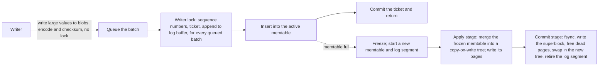

# Design

How lionturtle stores, reads and checkpoints data, what it guarantees, and how it is tested.

## Contents

- [How it works](#how-it-works)
- [Guarantees](#guarantees)
- [Differences from the C++ TurtleKV](#differences-from-the-c-lionturtle)
- [Testing](#testing)
- [Code layout](#code-layout)

## How it works

### Write path

A writer first writes each large value of its batch to a [blob](#blobs), and its record carries a pointer in the value's place. Each writer queues its pre-encoded record, and whichever writer holds the lock serves every queued batch in one turn: it assigns sequence numbers and tickets and appends the records. Waiting writers spin briefly, then park until their batch is served or the lock is free. Under contention one lock handoff serves many batches, which matters most across NUMA nodes, where each handoff costs a cross-socket cache miss. Two background stages checkpoint frozen memtables: one applies the next while the other commits the last. Writers wait only when two frozen memtables await checkpoints, so a checkpoint can run past the next memtable's filling, as when the drive slows for a few seconds, without stopping writers. A checkpoint cuts its memtable into batches on one thread while another applies them, and two more write its new pages as they come, holding back the newest quarter of the cache in case a later batch replaces them. Its I/O is paced after the SILK paper; see [Reads during sustained writes](BENCHMARKS.md#reads-during-sustained-writes).

### Memtable memory

The default memtable keeps its keys, values, versions and tree nodes in an arena: 2 MiB chunks that lionturtle maps itself and fills by advancing a pointer. Each writer thread takes a block of the arena at a time, so an insert allocates without a lock. A dropped memtable hands its chunks to a pool, and the next memtable takes them from there, still resident. Each memtable's Bloom filter comes from the same pool, and each log segment passes its buffers to the next, so a rotation asks the general allocator for no large block. Chunks that go unused for 30 seconds return to the system, so an idle store holds no idle memtable memory. A value of 4 KiB or more keeps a buffer of its own, which reads share; a read copies a shorter value out of the arena.

A write batch's ops go to the memtable's tree eight at a time, and the eight lookups overlap their cache misses. An overwrite returns its copy of the key to the arena.

The general allocator serves a memtable poorly. With each entry in blocks of mimalloc's, a memtable of 2.3 million 50-byte entries took 360 to 400 ms to drop, on whichever thread released its last reference, and an insert took 350 to 410 ns. From the arena, on the same 16-core EPYC 4564P, the drop takes 10 µs, and an insert takes 270 ns alone and 180 ns in a batch. `cargo run --release --example memtable_churn` measures both.

### The TurtleTree

Each interior node holds up to 64 pivots and buffers updates in up to four levels. Level *i* holds up to 2^*i* leaf-sized sorted runs. Inserting a batch merges it with the occupied prefix of levels, like incrementing a binary counter. After each insert the node flushes one leaf-sized batch to the child with the most buffered bytes. Leaves hold up to 4 MiB.

Pages are immutable: checksummed 4 KiB blocks, a sparse block index, and a Bloom filter. Each power-of-two size class lives in one sparse arena file. A double-slot superblock names the current tree. An epoch chain frees a page only after every reader of older tree versions has finished.

With `Options::compression` at `Lz4`, its default, a page goes to disk with each block compressed on its own and padded to a 4 KiB page, followed by a map of where each block starts, so a point read that misses the cache reads one aligned page, as it does without compression. Packing compressed blocks end to end would save the padding but leave about half of them straddling two pages: on YCSB C at 50M records, packed blocks read 60% more from the drive than uncompressed ones. To keep the padding small, each block holds about as many entries as compress into one page. The store sizes blocks from the pages it writes, aiming each so that a block compressing as poorly as the worst one in a hundred of a recent page still fits, since a block that spills into a second page wastes more than the others leave unused. On values that compress to half their size, compressed blocks fill about 95% of their pages. A block that would take as many pages compressed as not is stored as it is. Pages in memory, in the cache, and in flight to the writers stay uncompressed, so merges of recent pages and reads of cached blocks cost what they do without compression; only a read from disk decompresses, once per block it brings into the cache. While blocks would hold under an eighth more entries per page, too few to pay for compressing every block and decompressing every read from disk, the store builds its pages padded and stores them as their images, as it would without compression, and compresses one block in eight only to learn whether that has changed. Each page records how it was stored, so a store can switch compression on or off between opens.

### Reads

- **Get:** the active memtable, then the frozen one, then the tree, at each node checking each buffer level's segment that covers the key. Each memtable keeps a Bloom filter of its keys, one bit per 8 bytes of memtable (2 MiB for 128 MiB), and a get searches only the memtables whose filter admits the key. Searching a large memtable misses the CPU cache at every level of it; on 10M cached records with uniform keys, the filters raised read throughput by 21%. A writer sets its keys' bits before inserting them, which adds about 0.2 µs to a write of a new key.
- **Scan:** a merge of the memtables with the tree, one leaf's key range at a time. Each range merges the leaf with the buffer levels of every node on its path, and background threads start the first reads of its cold sources together.
- **Reverse scan:** the same merge run backward one window at a time. Each window is merged forward and returned in reverse. The first spans one leaf block, and each next one doubles, up to 32 blocks. On 4.2M cached entries, a full reverse pass takes 89 ns per entry against 62 forward; a 100-entry scan takes 25 µs against 13.
- **Cache:** a byte-weighted cache of blocks. A freshly written page enters whole, for the next merge to read. Point reads and scans read from such an image without keeping it resident, so under skewed reads the cache holds hot blocks rather than whole pages.

### Visibility

Each batch takes a ticket under the writer lock and registers it. Its versions carry the ticket. Once every op is in the memtable, the writer marks the ticket committed and returns. A get takes the newest version whose batch has committed. Committed tickets fold into a visible prefix of sequence numbers. A snapshot waits until the batches registered before it commit, then reads that prefix. It also holds the version it started from: the memtables and tree root of that moment. A synchronous batch commits after its fsync, so a snapshot taken meanwhile waits for that fsync; a get does not.

### Range deletes

A range delete is an op like a put: it takes a sequence number and becomes visible with its batch, and a batch's ops apply in order. A memtable keeps its range deletes beside its point versions, in immutable sorted runs that merge like a binary counter, after Bentley and Saxe. Each run cuts its key space into fragments that one set of deletes covers, and records the newest delete of each, so a read finds the newest delete covering a key with one binary search per run, and a memtable with `n` deletes holds at most one run per bit of `n`.

- **Get:** looks up the key's newest version, then the newest range delete covering it, and if there is one, a version newer than the delete. A batch's range deletes are in their memtable before it commits, so a get that found a version from a committed batch finds that batch's range deletes too. A get that finds a newer version reads the deletes again, since its batch may have committed meanwhile. Either way, no get sees half of a batch that both writes and range-deletes a key.
- **Scan:** walks the key space in spans over which the newest delete the snapshot sees stays the same. Under a delete, the tree and every memtable older than the delete skip to the span's end, and newer memtables show only versions newer than it. A reverse scan starts its tree window below the keys a delete covers.
- **Checkpoint:** applies the memtable's range deletes to the tree before its entries, since everything in the tree is older. It drops each subtree that lies inside a range without reading it, handing the subtree's key range to a neighbour, and marks the range dead in each buffered segment it reaches, as a flush marks the keys it moves to a child. A leaf a range cuts keeps its keys in the range: at most two leaves per range. The checkpoint finds those keys and writes a tombstone for each into its batches, which leave out the memtable entries a newer range delete covers. A segment left holding more dead ranges than its page has blocks is rewritten, so many small range deletes cannot grow node pages without bound.

The tree never holds a range delete. Once its checkpoint commits, reads pay nothing for it, and the pages of the subtrees it dropped return to the allocator when the readers of older versions finish.

### Blobs

A value of at least `Options::blob_threshold` bytes lives apart from the tree, in a blob. Its writer compresses it, checksums it and writes it to a slot of its own with one direct write, then logs the put with a 21-byte pointer in the value's place. The memtable keeps the value for reads and the pointer for the checkpoint, which gives the tree the pointer. Merges and flushes then move the pointer, so the value reaches the drive once, where a value in the tree is rewritten at each buffer level it passes.

Writers write their blobs on their own threads, outside every lock. Many large writes proceed at once, none copies its value into the log's buffer under the writer lock, and a checkpoint of large values merges a few kilobytes of pointers.

- **Slots.** Blob arenas are page arenas under another name: one sparse file per power-of-two size class, `blobs-<class>.dat`, with the same allocator and hole punching. Each blob frees on its own, so the store runs no garbage collector that copies live values out of shared files, as WiscKey's and BlobDB's do. Blobs keep to their own files so that punching a blob's hole, which locks its file against reads on XFS, leaves reads of the tree alone.
- **Reuse.** Overwrites free slots as fast as they take them, so freed blob slots keep their disk space for reuse, up to four memtables' worth (512 MiB by default); past that, the slots freed longest ago are punched. A blob takes a free slot that held a blob of its length or up to an eighth more, since compressed values of one size vary a little, and the blocks past its end wait for the slot's next release. An overwrite thus lands on allocated blocks: the file system allocates and journals nothing, and on ext4 the write shares the file's lock with other writes.
- **Liveness.** Each page lists the blobs its entries point to in its metadata, which stays in memory, and the store counts, for each blob, the pages of the durable tree that list it. A checkpoint commit counts the pages it added and stops counting those it dropped. A blob no page lists is freed once the readers of older versions finish, as a dropped page is. A flush copies an entry to a child and leaves the original in its segment's page until that page is rewritten, so two pages can list one blob, and an overwritten blob lives as long as an overwritten value's bytes do in the tree. A range delete frees the blobs of the subtrees it drops without reading the subtrees or the blobs. A blob whose put was overwritten or deleted within its memtable never reaches the tree, and its checkpoint's commit frees it.
- **Reads.** A get finds the pointer in the tree, reads the blob through the page cache, verifies it and decompresses it. A value of up to 256 KiB then enters the block cache, so reads of a hot value share one buffer and skip all three steps. Longer values are left to the page cache, which holds them as stored: cached at their full length under a 4 GB memory cap, 1 MiB values took the page cache's share of memory and raised read p99.9 from 3.5 to 21 ms. A scan finds its entries first and then reads their blobs in order, keeping the reads of the next 4 MiB of blobs started ahead of the one it returns. An iterator reads each blob as it returns its entry, and a reverse iterator's window holds pointers until then.
- **Compression.** With LZ4, a blob is compressed whole when that saves at least an eighth of it. A value over 1 MiB is judged first by two 128 KiB samples, so one that does not compress costs no pass over the rest.
- **Durability.** A sync makes the blob arenas durable before the log, so every durable record's blobs are durable. A sync takes the records it will write, then syncs the arenas, then writes: each writer finishes its blobs before it queues its record, so the arenas hold every blob those records point to.
- **Recovery.** Without a sync, a crash can keep a record and lose its blob. Replay reads the blob of each logged put. A blob's checksum covers its id, and no id is used twice: the superblock reserves a range of ids durably before the store uses one of them, and each open starts past the last reservation. So a slot fails the checksum unless it holds the record's own blob, whether it holds an older blob, a torn one, or one written after the crash with the same length. A record whose blob fails ends the history, as a torn record does, and it fails the same way in every later recovery. Slots that neither the recovered tree nor a replayed record points to are free.
- **Values logged whole.** A large value reaches a memtable without a blob when replay reads a log written under a higher threshold. The checkpoint writes that value's blob as it cuts its batches, paced like its page writes.
- **Memory and the threshold.** The tree's page metadata holds 21 bytes per blob entry and the count about 40 more, so 1 TB of 1 MiB values costs about 60 MB and 1 TB of 32 KiB values about 2 GB. Each blob's slot is padded to 4 KiB, half a block per blob on average. Both costs double with each halving of the threshold. Values of 8 KiB and over ran faster as blobs than in the tree on every workload measured ([Large values](BENCHMARKS.md#large-values)); the default of 32 KiB keeps the memory near 2 GB per TB of the smallest blobs.

### Backups

`Db::backup` copies one checkpoint of a live store: its superblock, and each node page, data page and blob its tree references, as they are stored. Pages and blobs are immutable and checksummed, and a store rebuilds its free-slot map at open by walking its tree, so a superblock with the images it names is a whole store. The backup decompresses nothing and rebuilds nothing, and a restore writes each image back to its slot. A `Backup` yields its checkpoint as an archive, a stream of the images end to end, or as a copy that opens as a store. [BACKUPS.md](BACKUPS.md) covers how to use one, and [Backups](BENCHMARKS.md#backups) what it costs.

- **Sequence point.** A backup holds every write completed before `Db::backup` was called and none made after it returned, in whole batches. The call freezes the active memtable, if it holds anything, and waits for its checkpoint, which keeps its pace: on a store of 100M small rows serving 500,000 operations a second the wait was 2 to 3 s and the slowest second had a p99 of 39 ms, where a checkpoint at full speed held p99 near 170 ms for its second. The memtable is frozen once nothing is frozen ahead of it, so that it is paced as one that filled, and each checkpoint the backup waits on has its deadline brought in to four seconds. With nothing to flush, the backup starts at once. Its sequence number is the last one given out before the flush, which the checkpoint's own last write can fall short of: a range delete that covers no key takes a number and writes nothing.
- **Slot pins.** The backup holds each slot of its checkpoint until it has read it. When the tree drops a held slot's page, the page store sets the slot aside, and releases it once every backup that held it has let go. A backup reads each slot once, in an order it knows, so the store gets a superseded slot back as soon as the backup has passed it, and a page or blob written after the backup began is never held. A reader's version, which a backup could hold instead, keeps everything superseded while it lives: a copy at 200 MiB/s that held one grew a store of 1 MiB blobs from 8.7 to 20 GB while clients overwrote it at 250 MB/s, and with pins a backup of the same store peaked at 9.7 GB. A pin takes about 100 bytes of memory until its slot is read.
- **Reads.** The backup reads each arena front to back, past the page cache, so it takes none of the memory that serves clients. Under a rate limit it reads 256 KiB at a time, as a paced checkpoint writes, so a client's read queues behind one piece. `BackupOptions::rate_limit` defaults to 256 MiB/s. At that rate, reading a store of 100M small rows that served 500,000 operations a second moved the read p99 of a typical second from 5 to 5.5 ms. Unlimited, one thread reads 2 to 3 GB/s and moved it as little for the seconds it ran, where four threads reading 3.9 GB/s held client p99 at 0.8 s.
- **Verification.** A node page's checksum, each block's checksum, a page's metadata checksum and a blob's checksum all cover stored bytes, so the backup verifies each image as it reads it without decompressing any. A damaged image fails the backup, and a backup that finishes has read and verified every page and blob of its checkpoint.
- **Archive.** An archive is a header, one record per image, and a trailer. The header holds the superblock as the store encodes it, so a version that cannot open the store cannot restore its archive. A record holds the image's kind, its pointer, a checksum of those, and the image, which carries its own checksums. The trailer holds the record count and a checksum chained over every record's kind and pointer in order, so an archive that lost, gained or reordered a record fails, and one without its trailer is incomplete. The chain leaves out each record's checksum, because a checksum run over data followed by that data's own checksum comes out the same whatever the data was.
- **Copies and restores.** `Backup::copy_to` and `backup::restore` write each image to the slot it had in the source, sync the arenas, and write the superblock last. They create one arena durably before the first image arrives, so a destination that stopped part-way holds an arena and no superblock, which refuses to open, where an empty directory would open as a new store. The arenas keep the source's layout, free slots included, so they are sparse files: the arenas of a 100M-row store spanned 30 GB of offsets for 10.9 GB of data. An archive holds the images alone and suits any transport.
- **Where the backup goes.** A backup written to the drive the store is on shares it with the store's writes, and on a drive with a volatile write cache each of the store's syncs flushes the backup's writes too. An archive file beside the 100M-row store at 100 MiB/s moved a typical second's p99 from 5 to 8 ms. `Backup::archive_to` and `copy_to` write past the page cache: the same archive written through it, under a memory cap that counts it, held p99 at 445 ms.

## Guarantees

- **Durability.** A write without `sync` sits in a 1 MiB log buffer until the buffer fills, `Db::sync` runs, or its memtable's checkpoint commits. Each flush returns its buffer for the next, so appends land in resident memory. `write(.., true)` returns once its batch is durable, and the batch becomes visible then. Synchronous writers share fsyncs, and retired log segments are reused. With `preallocate_log`, a segment with none to reuse is written ahead as zeros, in a file of its own, before a memtable takes it: the first when the store opens, and later ones on a background thread paced to the active memtable's filling; see [Synchronous writes](BENCHMARKS.md#synchronous-writes). RocksDB groups synchronous writers too, and reuses logs only with `recycle_log_file_num`.
- **Log order.** A log segment's file holds a record only once the segment before it is durable, so the segments on disk always hold a prefix of history. A memtable rotation syncs nothing to keep that order, since it holds the writer lock: the new segment buffers its records, and its first flush or sync, on a thread without that lock, first syncs the old segment and the new one's directory entry. A sync of a segment that has taken no record still syncs the one before it.
- **Flushes at commit.** A sync has a drive with a volatile write cache flush it, and the writes in flight wait. A commit therefore syncs only what its checkpoint needs: its memtable's log segment, which brings the blobs that segment points to, the arena files the checkpoint wrote to, and the superblock, with one durable direct write of its 4 KiB slot. Syncing every arena file and fsyncing the superblock took 12 syncs a checkpoint. With 64 KiB values arriving at 1.4 GB/s, a checkpoint every 90 ms, that held insert p99 at 10.6 ms and the load at 22 thousand inserts a second, against 4.9 ms and 26.5 thousand with six syncs.
- **Visibility.** A get returns the newest version whose batch has committed. Concurrent writers to one key resolve in log order.
- **Snapshots hold resources.** A held snapshot or iterator keeps its memtables in memory and its tree's pages allocated until dropped. Drop them before reopening the store.
- **Backups.** A backup holds a prefix of history: every write completed before `Db::backup` was called, none made after it returned, and each batch whole. One that finishes without error has verified every page and blob it holds. A copy or a restore that fails leaves a destination that refuses to open. A backup in hand keeps each superseded slot of its checkpoint allocated until it has read it; finish or drop it before reopening the store.
- **Recovery** replays the log segments that follow the last committed checkpoint and keeps a prefix of history containing every synced write. A logged put of a large value counts as written only with its blob; see [Blobs](#blobs).
- **Range deletes and older versions.** lionturtle 0.6 and earlier would read a range delete in the log as a torn record and drop it and every write after it. So before a store logs its first range delete, it writes both superblock slots with a magic number those versions reject, and they refuse to open it. A store that never takes a range delete keeps the superblock they read.
- **Blobs and older versions.** A version without blobs would read a pointer as a value and a logged blob put as a torn record. So before a store writes its first blob, it writes both superblock slots with a magic those versions reject. That superblock also holds the blob id reservation and a byte of flags naming what a reader must understand. A store that never writes a blob keeps its superblock.

## Differences from the C++ TurtleKV

lionturtle follows the C++ TurtleTree: buffer levels that fill like a binary counter, one leaf-sized flush per insert, and one checkpoint per memtable. It departs in these ways:

- **Filters and indexes.** Bloom filters and a sparse block index replace quotient filters and the per-leaf trie.
- **Flushed keys.** Each buffered segment records the keys flushed out of it as key intervals plus a clip range. Pivot changes leave segment metadata alone, and flushes update it without reading pages.
- **Durability.** Both write the log with O_DIRECT; on macOS, which lacks it, lionturtle buffers the log. The C++ code counts write completion as durable, which holds only on drives whose write cache survives power loss. Here the log, page arenas and superblock are fsynced, and on Linux the kernel decides per drive whether that flushes a cache: on one that reports a write-through cache, as drives with power-loss protection and EC2 instance store do, it does not. On macOS every sync is an `F_FULLFSYNC`, which always flushes the drive's cache.
- **Free space.** Free space lives in memory and is rebuilt at open by walking the recovered tree, which punches holes in every free slot. Afterwards a freed slot is dropped from the page cache and reused with its space still allocated, by a page at least as long as the one it held, so the new page overwrites every block the slot holds. Only a slot left free through two more checkpoints is hole-punched, returning its space to the file system. On XFS a punch locks the file against reads, and punching every slot as it was freed raised read p99.9 on YCSB A at 400M records from 270 to 470 µs. Arena files grow ahead of their writes, since XFS allocates a direct write past the end of a file up to the next stripe boundary, and a reused slot would keep the excess.
- **Atomic visibility.** Memtables keep version chains, and batches commit independently, so readers see whole batches and iterators are snapshots.
- **Defaults.** 4 MiB leaves, 4 buffer levels and a fixed checkpoint distance of 32 leaves (128 MiB). The paper used 32 MB leaves and tuned checkpoint distance per workload.

The paper reports larger leads over RocksDB: about 5× on loads, over 4× on mixed workloads, and 2–9× on point queries. Its setup favored TurtleKV in ways [these benchmarks](BENCHMARKS.md) leave out:

- **Storage.** An Intel Optane P4800X, which answers reads in about 10 µs. Extra reads per operation cost little there.
- **Write memory.** TurtleKV's checkpoint distance ran from 512 MB to 3 GB, chosen per workload, against RocksDB's 64 MB write buffer. Here every engine gets 128 MiB.
- **Memory.** A 16 GB or 48 GB cache on a 128 GB machine with no cap on total memory. The 48 GB cache held the whole dataset. RocksDB ran direct I/O with only its block cache.

## Testing

`cargo test --release` runs the unit, model and threaded tests, and `cargo run --release --bin vopr -- --seeds 1000` runs 1,000 simulation seeds; `--seed <n> --verbose` replays one.

VOPR drives the store on one thread so seeds replay exactly. Each seed draws a store configuration, a key set with shared prefixes, values that are random or repeat a short pattern so their blocks compress, a blob threshold from every value to none, writes that include range deletes, alone and inside batches with the keys they cover, and a fault profile: lost unsynced sectors at power loss, failed reads, flipped bits, and failed writes and fsyncs. The oracle checks that every read matches the model, that recovery yields a prefix of history containing every synced write, that a clean reopen loses nothing, that every read through a held snapshot matches the model as it stood when the snapshot was taken, that each iterator, forward or reverse, over a range or a prefix, returns exactly its snapshot, that a backup holds every completed write when it starts and, copied or archived and restored any number of steps later, opens as a store with the model's state as of its start, that a read fault on the way fails the backup, that the count of pages listing each blob matches a count from the tree, and that no page or blob slot leaks, with backups in hand or without. Blob reads take the same faults as page reads, except during recovery, which tells a lost blob from a whole one by its checksum as it tells a torn log record.

Threaded tests cover what one thread cannot: concurrent writers, readers and scanners against background checkpoints, and batches that must stay whole to every reader on every memtable, including gets, scans and iterators of all kinds sharing one snapshot, and batches that write keys and range-delete them.

VOPR seeds and the threaded tests use small stores so that a short history reaches many checkpoints, which leaves out whatever grows only over a long history. A memtable keeps every version of a key, so a key written in every batch, as a commit timestamp is, collects millions of versions in one default-size memtable. The soak test runs the threaded workload at the default options with such a key, for 15 minutes nightly on x86_64 and arm64 Linux and on macOS: `LIONTURTLE_SOAK_SECS=900 cargo test --release --test concurrency -- --ignored soak_default_options`.

## Code layout

- `lionturtle/`: the store.
  - `db.rs`: write path, commit tickets, memtable rotation, the checkpoint pipeline, recovery, page reclamation.
  - `tree/`: the TurtleTree, its cursors and scans, range deletes applied at checkpoints, the page cache and prefetch.
  - `page.rs`, `bloom.rs`, `pagestore.rs`: pages, filters, arenas and the superblock.
  - `blob.rs`: blob pointers and the stored form of a blob.
  - `backup.rs`: backups, the archive format, restore and verification.
  - `memtable.rs`, `arena.rs`, `rangedel.rs`, `wal.rs`, `storage.rs`: memtables, their memory and their range deletes, the log, and the storage traits.
  - `sim/`: the simulated disk, the VOPR driver, and a deterministic write-amplification simulator.
- `kvbench/`: the YCSB driver for lionturtle, RocksDB, fjall and ScyllaDB, and an in-memory index benchmark.
- `bench/aws/`: EC2 benchmark scripts.
