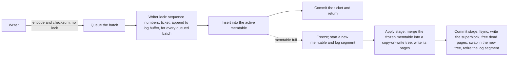

# Design

How lionturtle stores, reads and checkpoints data, what it guarantees, and how it is tested.

## Contents

- [How it works](#how-it-works)
- [Guarantees](#guarantees)
- [Differences from the C++ TurtleKV](#differences-from-the-c-lionturtle)
- [Testing](#testing)
- [Code layout](#code-layout)

## How it works

### Write path

Each writer queues its pre-encoded record, and whichever writer holds the lock serves every queued batch in one turn: it assigns sequence numbers and tickets and appends the records. Waiting writers spin briefly, then park until their batch is served or the lock is free. Under contention one lock handoff serves many batches, which matters most across NUMA nodes, where each handoff costs a cross-socket cache miss. Two background stages checkpoint frozen memtables: one applies the next while the other commits the last. Writers wait only when two frozen memtables await checkpoints, so a checkpoint can run past the next memtable's filling, as when the drive slows for a few seconds, without stopping writers. A checkpoint cuts its memtable into batches on one thread while another applies them, and two more write its new pages as they come, holding back the newest quarter of the cache in case a later batch replaces them. Its I/O is paced after the SILK paper; see [Reads during sustained writes](BENCHMARKS.md#reads-during-sustained-writes).

### The TurtleTree

Each interior node holds up to 64 pivots and buffers updates in up to four levels. Level *i* holds up to 2^*i* leaf-sized sorted runs. Inserting a batch merges it with the occupied prefix of levels, like incrementing a binary counter. After each insert the node flushes one leaf-sized batch to the child with the most buffered bytes. Leaves hold up to 4 MiB.

Pages are immutable: checksummed 4 KiB blocks, a sparse block index, and a Bloom filter. Each power-of-two size class lives in one sparse arena file. A double-slot superblock names the current tree. An epoch chain frees a page only after every reader of older tree versions has finished.

With `Options::compression` at `Lz4`, its default, a page goes to disk with each block compressed on its own and padded to a 4 KiB page, followed by a map of where each block starts, so a point read that misses the cache reads one aligned page, as it does without compression. Packing compressed blocks end to end would save the padding but leave about half of them straddling two pages: on YCSB C at 50M records, packed blocks read 60% more from the drive than uncompressed ones. To keep the padding small, each block holds about as many entries as compress into one page. The store sizes blocks from the pages it writes, aiming each so that a block compressing as poorly as the worst one in a hundred of a recent page still fits, since a block that spills into a second page wastes more than the others leave unused. On values that compress to half their size, compressed blocks fill about 95% of their pages. A block that would take as many pages compressed as not is stored as it is. Pages in memory, in the cache, and in flight to the writers stay uncompressed, so merges of recent pages and reads of cached blocks cost what they do without compression; only a read from disk decompresses, once per block it brings into the cache. While blocks would hold under an eighth more entries per page, too few to pay for compressing every block and decompressing every read from disk, the store builds its pages padded and stores them as their images, as it would without compression, and compresses one block in eight only to learn whether that has changed. Each page records how it was stored, so a store can switch compression on or off between opens.

### Reads

- **Get:** the active memtable, then the frozen one, then the tree, at each node checking each buffer level's segment that covers the key. Each memtable keeps a Bloom filter of its keys, one bit per 8 bytes of memtable (2 MiB for 128 MiB), and a get searches only the memtables whose filter admits the key. Searching a large memtable misses the CPU cache at every level of it; on 10M cached records with uniform keys, the filters raised read throughput by 21%. A writer sets its keys' bits before inserting them, which adds about 0.2 µs to a write of a new key.
- **Scan:** a merge of the memtables with the tree, one leaf's key range at a time. Each range merges the leaf with the buffer levels of every node on its path.
- **Reverse scan:** the same merge run backward one window at a time. Each window is merged forward and returned in reverse. The first spans one leaf block, and each next one doubles, up to 32 blocks. On 4.2M cached entries, a full reverse pass takes 89 ns per entry against 62 forward; a 100-entry scan takes 25 µs against 13.
- **Cache:** a byte-weighted cache of blocks. A freshly written page enters whole, for the next merge to read. Point reads and scans read from such an image without keeping it resident, so under skewed reads the cache holds hot blocks rather than whole pages.

### Visibility

Each batch takes a ticket under the writer lock and registers it. Its versions carry the ticket. Once every op is in the memtable, the writer marks the ticket committed and returns. A get takes the newest version whose batch has committed. Committed tickets fold into a visible prefix of sequence numbers. A snapshot waits until the batches registered before it commit, then reads that prefix. It also holds the version it started from: the memtables and tree root of that moment. A synchronous batch commits after its fsync, so a snapshot taken meanwhile waits for that fsync; a get does not.

## Guarantees

- **Durability.** A write without `sync` sits in a 1 MiB log buffer until the buffer fills, `Db::sync` runs, or the memtable rotates. `write(.., true)` returns once its batch is durable, and the batch becomes visible then. Synchronous writers share fsyncs, and retired log segments are reused. With `preallocate_log`, segments with none to reuse are zero-filled ahead of their writes; see [Synchronous writes](BENCHMARKS.md#synchronous-writes). RocksDB groups synchronous writers too, and reuses logs only with `recycle_log_file_num`.
- **Visibility.** A get returns the newest version whose batch has committed. Concurrent writers to one key resolve in log order.
- **Snapshots hold resources.** A held snapshot or iterator keeps its memtables in memory and its tree's pages allocated until dropped. Drop them before reopening the store.
- **Recovery** replays the log segments that follow the last committed checkpoint and keeps a prefix of history containing every synced write.

## Differences from the C++ TurtleKV

lionturtle follows the C++ TurtleTree: buffer levels that fill like a binary counter, one leaf-sized flush per insert, and one checkpoint per memtable. It departs in these ways:

- **Filters and indexes.** Bloom filters and a sparse block index replace quotient filters and the per-leaf trie.
- **Flushed keys.** Each buffered segment records the keys flushed out of it as key intervals plus a clip range. Pivot changes leave segment metadata alone, and flushes update it without reading pages.
- **Durability.** Both write the log with O_DIRECT; on macOS, which lacks it, lionturtle buffers the log. The C++ code counts write completion as durable, which holds only on drives whose write cache survives power loss. Here the log, page arenas and superblock are fsynced, and on Linux the kernel decides per drive whether that flushes a cache: on one that reports a write-through cache, as drives with power-loss protection and EC2 instance store do, it does not. On macOS every sync is an `F_FULLFSYNC`, which always flushes the drive's cache.
- **Free space.** Free space lives in memory and is rebuilt at open by walking the recovered tree, which punches holes in every free slot. Afterwards a freed slot is dropped from the page cache and reused with its space still allocated, by a page at least as long as the one it held, so the new page overwrites every block the slot holds. Only a slot left free through two more checkpoints is hole-punched, returning its space to the file system. On XFS a punch locks the file against reads, and punching every slot as it was freed raised read p99.9 on YCSB A at 400M records from 270 to 470 µs. Arena files grow ahead of their writes, since XFS allocates a direct write past the end of a file up to the next stripe boundary, and a reused slot would keep the excess.
- **Atomic visibility.** Memtables keep version chains, and batches commit independently, so readers see whole batches and iterators are snapshots.
- **Defaults.** 4 MiB leaves, 4 buffer levels and a fixed checkpoint distance of 32 leaves (128 MiB). The paper used 32 MB leaves and tuned checkpoint distance per workload.

The paper reports larger leads over RocksDB: about 5× on loads, over 4× on mixed workloads, and 2–9× on point queries. Its setup favored TurtleKV in ways [these benchmarks](BENCHMARKS.md) leave out:

- **Storage.** An Intel Optane P4800X, which answers reads in about 10 µs. Extra reads per operation cost little there.
- **Write memory.** TurtleKV's checkpoint distance ran from 512 MB to 3 GB, chosen per workload, against RocksDB's 64 MB write buffer. Here every engine gets 128 MiB.
- **Memory.** A 16 GB or 48 GB cache on a 128 GB machine with no cap on total memory. The 48 GB cache held the whole dataset. RocksDB ran direct I/O with only its block cache.

## Testing

`cargo test --release` runs the unit, model and threaded tests, and `cargo run --release --bin vopr -- --seeds 1000` runs 1,000 simulation seeds; `--seed <n> --verbose` replays one.

VOPR drives the store on one thread so seeds replay exactly. Each seed draws a store configuration, a key set with shared prefixes, values that are random or repeat a short pattern so their blocks compress, and a fault profile: lost unsynced sectors at power loss, failed reads, flipped bits, and failed writes and fsyncs. The oracle checks that every read matches the model, that recovery yields a prefix of history containing every synced write, that a clean reopen loses nothing, that every read through a held snapshot matches the model as it stood when the snapshot was taken, that each iterator, forward or reverse, over a range or a prefix, returns exactly its snapshot, and that no page slot leaks.

Threaded tests cover what one thread cannot: concurrent writers, readers and scanners against background checkpoints, and batches that must stay whole to every reader on every memtable, including gets, scans and iterators of all kinds sharing one snapshot.

VOPR seeds and the threaded tests use small stores so that a short history reaches many checkpoints, which leaves out whatever grows only over a long history. A memtable keeps every version of a key, so a key written in every batch, as a commit timestamp is, collects millions of versions in one default-size memtable. The soak test runs the threaded workload at the default options with such a key, for 15 minutes nightly on x86_64 and arm64 Linux and on macOS: `LIONTURTLE_SOAK_SECS=900 cargo test --release --test concurrency -- --ignored soak_default_options`.

## Code layout

- `lionturtle/`: the store.
  - `db.rs`: write path, commit tickets, memtable rotation, the checkpoint pipeline, recovery, page reclamation.
  - `tree/`: the TurtleTree, its cursors and scans, the page cache and prefetch.
  - `page.rs`, `bloom.rs`, `pagestore.rs`: pages, filters, arenas and the superblock.
  - `memtable.rs`, `wal.rs`, `storage.rs`: memtables, the log, and the storage traits.
  - `sim/`: the simulated disk, the VOPR driver, and a deterministic write-amplification simulator.
- `kvbench/`: the YCSB driver for lionturtle, RocksDB, fjall and ScyllaDB, and an in-memory index benchmark.
- `bench/aws/`: EC2 benchmark scripts.
