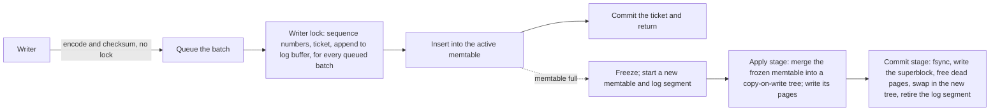

# turtlekv-rs

An embedded key-value store in Rust built on the TurtleTree from [TurtleKV](https://github.com/mathworks/turtle_kv) ([paper](https://arxiv.org/abs/2509.10714)). It writes fewer bytes than RocksDB and fjall, and on a workstation it outpaces both on every YCSB workload.

A VOPR-style deterministic simulator checks it: seeded runs crash the store, corrupt its disk, and compare every answer and every recovery against a model.

## Contents

- [What sets it apart](#what-sets-it-apart)
- [Performance](#performance)
  - [On EC2 at 400M records](#on-ec2-at-400m-records)
  - [Where it wins and where it pays](#where-it-wins-and-where-it-pays)
  - [fjall in these runs](#fjall-in-these-runs)
  - [Synchronous writes](#synchronous-writes)
  - [How the benchmark is run](#how-the-benchmark-is-run)
- [Behavior compared with RocksDB and fjall](#behavior-compared-with-rocksdb-and-fjall)
- [Differences from the C++ TurtleKV](#differences-from-the-c-turtlekv)
- [Quick start](#quick-start)
- [How it works](#how-it-works)
  - [Write path](#write-path)
  - [The TurtleTree](#the-turtletree)
  - [Reads](#reads)
  - [Visibility](#visibility)
- [Configuration](#configuration)
- [Development](#development)

## What sets it apart

- **Fewer bytes written.** Each full memtable becomes one checkpoint of a Bε-tree, so a key overwritten within one checkpoint reaches disk once. Loading 50M records wrote 5.9 bytes per user byte, against RocksDB's 7.7 and fjall's 8.5.
- **Batches are atomic to readers.** A batch survives a crash whole or not at all, and no reader sees half of one. Writers commit independently, so one slow insert delays no other writer.
- **Explicit snapshots.** `Db::snapshot` returns a handle that any number of reads and iterators can share, and every read through it sees the same batches. Each iterator is a snapshot too: it sees every batch written before it was created and none after.
- **One knob trades memory for write cost.** Checkpoint distance χ sets the memtable size. A larger memtable absorbs more overwrites per checkpoint and writes fewer pages.
- **Checked by deterministic simulation.** Each VOPR seed runs a random store configuration through writes, reads, iterators, checkpoints, crashes, torn writes, read errors and bit flips on a simulated disk. A failing seed replays exactly. See [Testing](#testing).

## Performance

50M records of 8-byte keys and 120-byte values (6.4 GB of user data) on a workstation, under a 4 GB memory cap that covers page cache. Every engine got a 1 GB block cache, 128 MiB memtables and 16 client threads.

| Workload (thousand ops/s) | turtlekv-rs | RocksDB | fjall | vs RocksDB |
|---|--:|--:|--:|--:|
| Load (inserts) | 993 | 692 | 402 | 1.43× |
| A: 50% read, 50% update | 1,253 | 905 | 477 | 1.38× |
| B: 95% read, 5% update | 1,568 | 965 | 799 | 1.62× |
| C: 100% read | 1,622 | 965 | 819 | 1.68× |
| E: 95% scan of up to 100 keys, 5% insert | 181 | 144 | 44 | 1.26× |
| F: 50% read, 50% read-modify-write | 763 | 610 | 422 | 1.25× |
| Write amplification during load | 5.9 | 7.7 | 8.5 | |
| Disk after load (GB) | 7.4 | 7.5 | 8.9 | |
| RSS during reads (GB) | 1.8 | 1.5 | 2.0 | |

Read p99 on workload C was 81 µs for turtlekv-rs, 151 µs for RocksDB and 160 µs for fjall. Scan p50 on E was 25, 28 and 87 µs. The machine was an Intel Core Ultra 9 285 (24 cores) with one NVMe drive on ext4.

### On EC2 at 400M records

400M records (51 GB of user data) on i7ie.48xlarge (192 vCPUs, 16 NVMe drives in RAID 0 under XFS), under a 16 GB memory cap that covers page cache. Every engine got a 4 GB block cache, 128 MiB memtables and 32 client threads; RocksDB loaded with 8, its fastest.

| Workload (thousand ops/s) | turtlekv-rs | RocksDB | fjall | vs RocksDB |
|---|--:|--:|--:|--:|
| Load (inserts) | 550 | 473 | 311 | 1.16× |
| A: 50% read, 50% update | 487 | 296 | 180 | 1.65× |
| B: 95% read, 5% update | 467 | 399 | 357 | 1.17× |
| C: 100% read | 446 | 379 | 354 | 1.18× |
| E: 95% scan of up to 100 keys, 5% insert | 94 | 84 | 40 | 1.13× |
| F: 50% read, 50% read-modify-write | 298 | 227 | 143 | 1.31× |
| Write amplification during load | 9.0 | 13.5 | 15.5 | |
| Disk after load (GB) | 63.9 | 55.8 | 55.4 | |
| RSS during reads (GB) | 7.0 | 6.0 | 6.6 | |

Reads at this scale wait on the drives: read p99 on C was 550 µs for turtlekv-rs, 577 µs for RocksDB and 588 µs for fjall. Scan p50 on E was 63, 50 and 499 µs. turtlekv-rs ran on a second instance of the same type. In a separate test on one instance, with the page cache dropped before each run, E ran at 101 thousand scans per second for turtlekv-rs and 73 for RocksDB, three runs each.

### Where it wins and where it pays

- **Writes.** A checkpoint merges a whole memtable into the tree at once, and buffer levels absorb several checkpoints before data reaches the leaves. Loads lead by 1.43×, and the mixed workloads A and F by 1.25–1.38×.
- **Point reads.** A get checks the memtables, then walks root to leaf. At each node it checks one Bloom filter per buffer level and reads at most one 4 KiB block. Page metadata (block index and filters) stays in memory, so a miss in the cache costs one device read.
- **Scans.** A scan merges the leaf with every buffer level on its root-to-leaf path: up to nine sorted runs with the default four levels. In a cold key range each run can need its own device read. A scan starts those reads together before reading any, along with the leaf's next block when it expects to read more than half a block, so a cold range costs about one read latency. An LSM tree keeps about 90% of its data in the last level, so its scans touch fewer runs.
- **Memory.** Page metadata stays resident: about 1 GB per 400M keys, outside the block cache. Memtables keep every version of a key until the next checkpoint. RSS at equal cache sizes runs above RocksDB's, which leaves less page cache under a cap.

### fjall in these runs

fjall trails here by more than its own benchmarks suggest, because these runs use 16–32 client threads and scan after update phases. Both stress parts of fjall's design:

- **One journal lock.** Every fjall write takes one journal mutex, so loads slow as threads grow. On the workstation at 10M records, fjall loaded 781 thousand inserts per second on one thread, ahead of RocksDB's 681, and 435 thousand on 16.
- **Version skipping.** A fjall scan steps past a key's older versions one at a time; RocksDB reseeks after eight. Zipfian updates pile versions onto hot keys, so E after A and B scans slowly: on 2M records with one thread, fjall ran 106–125 thousand scans per second after the load and 7.6 thousand after 400 thousand operations of workload A.
- **Synchronous writes.** fjall persists its journal once per writer, without grouping, so more threads add no durable throughput: on EC2 it fell from 31 thousand per second on one thread to 19 thousand on 64.

### Synchronous writes

`write(.., true)` returns once its batch is durable. Synchronous writers share syncs: one writer at a time writes every buffered record in one direct write and makes it durable, and the others return when a sync covers them. When every earlier log write is already durable, that write is one `pwritev2` with `RWF_DSYNC`; otherwise it is a write and an fsync. The log bypasses the page cache and writes over retired segments, so a sync has no dirty pages to write back and no file size to journal.

Thousand durable updates per second, from `bench/sync.sh` (3M records, 128 MiB memtables, background work finished first), median of three runs:

| Client threads | turtlekv-rs | RocksDB | RocksDB, recycled logs | fjall |
|---|--:|--:|--:|--:|
| Workstation NVMe, 1 | 0.5 | 0.2 | 0.5 | 0.5 |
| Workstation NVMe, 16 | 3.7 | 2.2 | 3.9 | 0.5 |
| Workstation NVMe, 64 | 15.1 | 7.3 | 14.2 | 0.4 |
| EC2 instance store, 1 | 33.6 | 11.5 | 30.4 | 31.0 |
| EC2 instance store, 16 | 157.1 | 71.1 | 144.2 | 27.0 |
| EC2 instance store, 64 | 337.8 | 187.9 | 288.0 | 18.8 |

The workstation drive (ext4) has a volatile write cache, so every sync waits about 2 ms for a cache flush. EC2 i7ie instance store (XFS on RAID 0) reports a write-through cache, as drives with power-loss protection do, so Linux sends no flush: a sync write costs one 4 KiB write, 30 µs on average for turtlekv-rs on one thread.

The EC2 rows ran with the CPUs' C6 idle state disabled. C6 takes 190 µs to exit, and with it enabled, a tenth or more of writes wake a CPU from it. Then every engine's one-thread mean rises to 50–110 µs, runs swing by 40%, and no engine passes 43 thousand per second at 16 or 64 threads. For latency-sensitive storage, disable deep idle states: `sudo cpupower idle-set -D 10` disables those with an exit latency of 10 µs or more.

Power-loss protection needs no turtlekv-rs setting. Linux reads each drive's cache mode from `/sys/block/<drive>/queue/write_cache` and skips flushes on `write through`. A drive with power-loss protection that reports `write back` still gets flushes, which such drives finish quickly; writing `write through` to that file stops them, and is safe only when the cache really survives power loss.

### How the benchmark is run

`kvbench` drives every engine with the same keys, values, operation mix, operation counts and client threads.

- Each run is one process in one memory cgroup, with page cache counted against the cap.
- No engine compresses data, and no engine fsyncs per write. RocksDB buffers its log manually, fjall persists its journal manually, and turtlekv-rs buffers up to 1 MiB of log. `--sync 1` makes every write in the timed phases durable before it returns; `bench/sync.sh` runs that comparison.
- RocksDB runs on jemalloc, its production allocator. turtlekv-rs and fjall run on mimalloc.
- turtlekv-rs's Bloom filters use 12 bits per key against RocksDB's 10. The extra memory counts against its cap.
- On machines where RocksDB's write path collapses with many loading threads, `--load-threads` loads it with fewer, in the same process as the read phases.

```console
cargo build --release -p kvbench --features rocksdb
systemd-run --user --scope -p MemoryMax=4G -p MemorySwapMax=0 \
  ./target/release/kvbench --engine turtlekv --records 50000000 --ops 50000000 --threads 16
LD_PRELOAD=/usr/lib/x86_64-linux-gnu/libjemalloc.so.2 systemd-run --user --scope -p MemoryMax=4G -p MemorySwapMax=0 \
  ./target/release/kvbench --engine rocksdb --records 50000000 --ops 50000000 --threads 16
```

Each phase prints one JSON line with throughput, latency percentiles, bytes read and written, write amplification, RSS and disk use. `bench/aws/` runs the same sequence on an EC2 instance with RAID 0 over its NVMe drives and profiles the read phases.

## Behavior compared with RocksDB and fjall

| | turtlekv-rs | RocksDB | fjall 3 |
|---|---|---|---|
| Structure | Bε-tree, checkpointed once per memtable | Leveled LSM tree | Leveled LSM tree |
| Atomic batches | To recovery and to readers | `WriteBatch` | Batches across keyspaces |
| Snapshots | Explicit handles; each iterator reads one | Explicit snapshots | Explicit snapshots |
| Transactions | None | Pessimistic and optimistic | Serializable single-writer; optimistic with conflict checks |
| Namespaces | One keyspace | Column families | Keyspaces |
| Iteration | Forward, reverse, prefix | Forward, reverse, prefix | Forward, reverse, prefix |
| Compression | None | Several codecs | LZ4 |
| Large values | Inline, up to 16 MiB | Inline or BlobDB | Inline or key-value separation |
| Backpressure | Writers wait while one frozen memtable awaits its checkpoint | Slows and stops writes on L0 files and pending compaction | Delays writes as L0 runs pile up |

- **Durability.** A write without `sync` sits in a 1 MiB log buffer until the buffer fills, `Db::sync` runs, or the memtable rotates. `write(.., true)` returns once its batch is durable, and the batch becomes visible then. Synchronous writers share fsyncs, and retired log segments are reused; see [Synchronous writes](#synchronous-writes). RocksDB groups synchronous writers too, and reuses logs only with `recycle_log_file_num`.
- **Visibility.** A get returns the newest version whose batch has committed. Concurrent writers to one key resolve in log order.
- **Snapshots hold resources.** A held snapshot or iterator keeps its memtables in memory and its tree's pages allocated until dropped. Drop them before reopening the store.
- **Recovery** replays the log segments that follow the last committed checkpoint and keeps a prefix of history containing every synced write.

## Differences from the C++ TurtleKV

turtlekv-rs follows the C++ TurtleTree: buffer levels that fill like a binary counter, one leaf-sized flush per insert, and one checkpoint per memtable. It departs in these ways:

- **Filters and indexes.** Bloom filters and a sparse block index replace quotient filters and the per-leaf trie.
- **Flushed keys.** Each buffered segment records the keys flushed out of it as key intervals plus a clip range. Pivot changes leave segment metadata alone, and flushes update it without reading pages.
- **Durability.** Both write the log with O_DIRECT. The C++ code counts write completion as durable, which holds only on drives whose write cache survives power loss. Here the log, page arenas and superblock are fsynced, and the kernel decides per drive whether that flushes a cache: on one that reports a write-through cache, as drives with power-loss protection and EC2 instance store do, it does not.
- **Free space.** Free space lives in memory and is rebuilt at open by walking the recovered tree. A freed slot is hole-punched before reuse, returning its space to the file system.
- **Atomic visibility.** Memtables keep version chains, and batches commit independently, so readers see whole batches and iterators are snapshots.
- **Defaults.** 4 MiB leaves, 4 buffer levels and a fixed checkpoint distance of 32 leaves (128 MiB). The paper used 32 MB leaves and tuned checkpoint distance per workload.

The paper reports larger leads over RocksDB: about 5× on loads, over 4× on mixed workloads, and 2–9× on point queries. Its setup favored TurtleKV in ways this benchmark leaves out:

- **Storage.** An Intel Optane P4800X, which answers reads in about 10 µs. Extra reads per operation cost little there.
- **Write memory.** TurtleKV's checkpoint distance ran from 512 MB to 3 GB, chosen per workload, against RocksDB's 64 MB write buffer. Here every engine gets 128 MiB.
- **Memory.** A 16 GB or 48 GB cache on a 128 GB machine with no cap on total memory. The 48 GB cache held the whole dataset. RocksDB ran direct I/O with only its block cache.

## Quick start

```rust
use std::sync::Arc;
use turtlekv::storage::FsStorage;
use turtlekv::{Db, Options, WriteOp};

let db = Db::open(Arc::new(FsStorage::new("data")?), Options::default())?;
db.put(b"apple", b"red")?;
// One log record: recovery keeps both ops or neither, and readers never see one without the other.
db.write(&[WriteOp::put(&b"banana"[..], &b"yellow"[..]), WriteOp::delete(&b"apple"[..])], true)?;
let value = db.get(b"banana")?;
let rows = db.scan(b"a", Some(b"c"), 100)?;
let mut it = db.iter(b"", None); // a snapshot as of this call
while let Some((key, value)) = it.next()? { /* ... */ }

// Reads through one snapshot agree with each other, whatever is written meanwhile.
let snap = db.snapshot();
let fruit = snap.prefix(b"b"); // keys starting with "b", ascending
let newest = snap.iter_rev(b"a", Some(b"c")); // [a, c), descending
db.sync()?;
```

```console
cargo run --release -p turtlekv --example quickstart
```

The API is `put`, `delete`, `write` for batches, `get`, `scan`, `iter`, `iter_rev`, `prefix`, `prefix_rev`, `snapshot`, `sync`, `checkpoint` and `stats`. A `Snapshot` offers the same reads. Keys run to 64 KiB and values to 16 MiB.

## How it works

### Write path



Each writer queues its pre-encoded record, and whichever writer holds the lock serves every queued batch in one turn: it assigns sequence numbers and tickets and appends the records. Waiting writers spin briefly, then park until their batch is served or the lock is free. Under contention one lock handoff serves many batches, which matters most across NUMA nodes, where each handoff costs a cross-socket cache miss. Two background stages checkpoint frozen memtables: one applies the next while the other commits the last. Writers wait only when a frozen memtable still awaits its checkpoint.

### The TurtleTree

Each interior node holds up to 64 pivots and buffers updates in up to four levels. Level *i* holds up to 2^*i* leaf-sized sorted runs. Inserting a batch merges it with the occupied prefix of levels, like incrementing a binary counter. After each insert the node flushes one leaf-sized batch to the child with the most buffered bytes. Leaves hold up to 4 MiB.

Pages are immutable: checksummed 4 KiB blocks, a sparse block index, and a Bloom filter. Each power-of-two size class lives in one sparse arena file. A double-slot superblock names the current tree. An epoch chain frees a page only after every reader of older tree versions has finished.

### Reads

- **Get:** the active memtable, then the frozen one, then the tree, at each node checking each buffer level's segment that covers the key.
- **Scan:** a merge of the memtables with the tree, one leaf's key range at a time. Each range merges the leaf with the buffer levels of every node on its path.
- **Reverse scan:** the same merge run backward one window at a time. Each window is merged forward and returned in reverse. The first spans one leaf block, and each next one doubles, up to 32 blocks. On 4.2M cached entries, a full reverse pass takes 89 ns per entry against 62 forward; a 100-entry scan takes 25 µs against 13.
- **Cache:** a byte-weighted cache of blocks. A freshly written page enters whole, for the next merge to read. Point reads and scans read from such an image without keeping it resident, so under skewed reads the cache holds hot blocks rather than whole pages.

### Visibility

Each batch takes a ticket under the writer lock and registers it. Its versions carry the ticket. Once every op is in the memtable, the writer marks the ticket committed and returns. A get takes the newest version whose batch has committed. Committed tickets fold into a visible prefix of sequence numbers. A snapshot waits until the batches registered before it commit, then reads that prefix. It also holds the version it started from: the memtables and tree root of that moment. A synchronous batch commits after its fsync, so a snapshot taken meanwhile waits for that fsync; a get does not.

## Configuration

`Options` and `TreeConfig` fields, with defaults:

| Field | Default | Effect |
|---|---|---|
| `checkpoint_distance` | 32 | Memtable size in leaf-sized batches (χ). Larger cuts write amplification and costs memory. |
| `cache_bytes` | 1 GiB | Block and page-image cache |
| `memtable` | `BBTree` | Memtable implementation: `BBTree`, `SkipList`, `BTree`, or `Art8` (8-byte keys) |
| `max_frozen` | 1 | Frozen memtables allowed to await checkpointing before writers wait |
| `wal_buffer_bytes` | 1 MiB | Log bytes buffered before a write to the file |
| `merge_threads` | 4 | Threads for parallel merges and page writes; 0 uses the caller's rayon pool |
| `background` | true | Checkpoint on background threads; with false, callers drive `checkpoint_step` |
| `tree.leaf_size` | 4 MiB | Leaf and flush batch size |
| `tree.max_levels` | 4 | Buffer levels per node. More levels cut write amplification and slow reads. |
| `tree.filter_bits` | 12 | Bloom filter bits per key |
| `tree.max_pivots` | 64 | Pivots per node before it splits |

## Development

- `turtlekv/`: the store.
  - `db.rs`: write path, commit tickets, memtable rotation, the checkpoint pipeline, recovery, page reclamation.
  - `tree/`: the TurtleTree, its cursors and scans, the page cache and prefetch.
  - `page.rs`, `bloom.rs`, `pagestore.rs`: pages, filters, arenas and the superblock.
  - `memtable.rs`, `wal.rs`, `storage.rs`: memtables, the log, and the storage traits.
  - `sim/`: the simulated disk, the VOPR driver, and a deterministic write-amplification simulator.
- `kvbench/`: the YCSB driver for turtlekv-rs, RocksDB and fjall, and an in-memory index benchmark.
- `bench/aws/`: EC2 benchmark scripts.

### Testing

```console
cargo test --release                                   # unit, model and threaded tests
cargo run --release --bin vopr -- --seeds 1000         # 1,000 seeds from a random start
cargo run --release --bin vopr -- --seed 42 --verbose  # replay one seed
```

VOPR drives the store on one thread so seeds replay exactly. Each seed draws a store configuration, a key set with shared prefixes, and a fault profile: lost unsynced sectors at power loss, failed reads, flipped bits, and failed writes and fsyncs. The oracle checks that every read matches the model, that recovery yields a prefix of history containing every synced write, that a clean reopen loses nothing, that every read through a held snapshot matches the model as it stood when the snapshot was taken, that each iterator, forward or reverse, over a range or a prefix, returns exactly its snapshot, and that no page slot leaks.

Threaded tests cover what one thread cannot: concurrent writers, readers and scanners against background checkpoints, and batches that must stay whole to every reader on every memtable, including gets, scans and iterators of all kinds sharing one snapshot.

### Benchmarks

```console
cargo run --release -p kvbench --features rocksdb -- --engine turtlekv --records 10000000
cargo run --release -p kvbench --bin indexbench        # bbtree vs ART vs skip list
cargo run --release --bin simperf                      # deterministic write amplification across χ
```

On EC2, `bench/aws/launch.sh` starts a tagged spot instance, `setup.sh` builds RAID 0 over its instance-store drives and compiles the benchmarks, `exp.sh` runs one engine's YCSB sequence under a 16 GB cap with profiles of the read phases, and `teardown.sh` removes every tagged resource.
