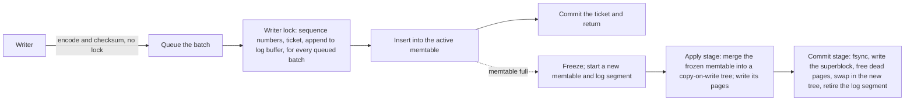

# turtlekv-rs

An embedded key-value store in Rust built on the TurtleTree from [TurtleKV](https://github.com/mathworks/turtle_kv) ([paper](https://arxiv.org/abs/2509.10714)). It writes fewer bytes than RocksDB and fjall and outpaces both on every YCSB workload of 128-byte records. With every write durable, it sustains more throughput than RocksDB and holds read p99 under half a millisecond up to 150k ops/s, where RocksDB's reached 603 ms.

A VOPR-style deterministic simulator checks it: seeded runs crash the store, corrupt its disk, and compare every answer and every recovery against a model.

## Contents

- [What sets it apart](#what-sets-it-apart)
- [Performance](#performance)
  - [On EC2 at 400M records](#on-ec2-at-400m-records)
  - [Clock speed](#clock-speed)
  - [Where it wins and where it pays](#where-it-wins-and-where-it-pays)
  - [fjall in these runs](#fjall-in-these-runs)
  - [Synchronous writes](#synchronous-writes)
  - [Durable writes under load](#durable-writes-under-load)
  - [Reads during sustained writes](#reads-during-sustained-writes)
  - [How the benchmark is run](#how-the-benchmark-is-run)
- [Behavior compared with RocksDB and fjall](#behavior-compared-with-rocksdb-and-fjall)
- [Differences from the C++ TurtleKV](#differences-from-the-c-turtlekv)
- [Quick start](#quick-start)
- [How it works](#how-it-works)
  - [Write path](#write-path)
  - [The TurtleTree](#the-turtletree)
  - [Reads](#reads)
  - [Visibility](#visibility)
- [Configuration](#configuration)
- [Development](#development)

## What sets it apart

- **Fewer bytes written.** Each full memtable becomes one checkpoint of a Bε-tree, so a key overwritten within one checkpoint reaches disk once. Loading 50M records wrote 5.8 bytes per user byte, against RocksDB's 7.6 and fjall's 8.7.
- **Batches are atomic to readers.** A batch survives a crash whole or not at all, and no reader sees half of one. Writers commit independently, so one slow insert delays no other writer.
- **Explicit snapshots.** `Db::snapshot` returns a handle that any number of reads and iterators can share, and every read through it sees the same batches. Each iterator is a snapshot too: it sees every batch written before it was created and none after.
- **Short tails with durable writes.** Checkpoints pace their I/O after the [SILK](https://www.usenix.org/conference/atc19/presentation/balmau) paper: each gets only the bandwidth it needs to finish before writers would wait on it, in small writes, and full bandwidth once writers would wait. With every update durable on an EC2 NVMe drive at 150k ops/s, read p99 was 0.35 ms against 603 ms for RocksDB, and the median update took 159 µs against 562 µs. At 70k ops/s, half of ScyllaDB's peak, read p99 was 0.23 ms against 9.3 ms for ScyllaDB. On a drive throttled to 200 MB/s at 15k ops/s, read p99 was 0.2 ms, against 344 ms for RocksDB with its auto-tuned rate limiter. See [Durable writes under load](#durable-writes-under-load) and [Reads during sustained writes](#reads-during-sustained-writes).
- **One knob trades memory for write cost.** Checkpoint distance χ sets the memtable size. A larger memtable absorbs more overwrites per checkpoint and writes fewer pages.
- **Checked by deterministic simulation.** Each VOPR seed runs a random store configuration through writes, reads, iterators, checkpoints, crashes, torn writes, read errors and bit flips on a simulated disk. A failing seed replays exactly. See [Testing](#testing).

## Performance

50M records of 8-byte keys and 120-byte values (6.4 GB of user data) on an EC2 i7ie.6xlarge (24 vCPUs, one instance-store NVMe drive under ext4), under a 4 GB memory cap that covers page cache. Every engine got a 1 GB block cache, 128 MiB memtables and 16 client threads.

| Workload (thousand ops/s) | turtlekv-rs | RocksDB | fjall | vs RocksDB |
|---|--:|--:|--:|--:|
| Load (inserts) | 1,417 | 867 | 382 | 1.63× |
| A: 50% read, 50% update | 1,180 | 958 | 511 | 1.23× |
| B: 95% read, 5% update | 1,028 | 902 | 705 | 1.14× |
| C: 100% read | 1,041 | 883 | 732 | 1.18× |
| E: 95% scan of up to 100 keys, 5% insert | 149 | 135 | 43 | 1.10× |
| F: 50% read, 50% read-modify-write | 680 | 646 | 464 | 1.05× |
| Write amplification during load | 5.8 | 7.6 | 8.7 | |
| Disk after load (GB) | 8.0 | 7.7 | 8.2 | |
| RSS during reads (GB) | 2.0 | 1.6 | 2.0 | |

Read p99 on workload C was 105 µs for turtlekv-rs, 118 µs for RocksDB and 138 µs for fjall. Scan p50 on E was 39, 37 and 124 µs.

### On EC2 at 400M records

400M records (51 GB of user data) on i7ie.48xlarge (192 vCPUs, 16 NVMe drives in RAID 0 under XFS), under a 16 GB memory cap that covers page cache. Every engine got a 4 GB block cache, 128 MiB memtables and 32 client threads; RocksDB loaded with 8, its fastest.

| Workload (thousand ops/s) | turtlekv-rs | RocksDB | fjall | vs RocksDB |
|---|--:|--:|--:|--:|
| Load (inserts) | 877 | 458 | 311 | 1.92× |
| A: 50% read, 50% update | 1,236 | 1,010 | 379 | 1.22× |
| B: 95% read, 5% update | 1,250 | 1,105 | 904 | 1.13× |
| C: 100% read | 1,320 | 1,093 | 910 | 1.21× |
| E: 95% scan of up to 100 keys, 5% insert | 227 | 220 | 37 | 1.03× |
| F: 50% read, 50% read-modify-write | 808 | 731 | 430 | 1.11× |
| Write amplification during load | 9.0 | 13.5 | 15.2 | |
| Disk after load (GB) | 61.9 | 56.7 | 56.0 | |
| RSS during reads (GB) | 7.1 | 6.1 | 6.6 | |

Most reads hit memory: median read latency on C was under 5 µs for every engine. The rest wait on the drives, and read p99 on C was 113 µs for turtlekv-rs, 134 µs for RocksDB and 153 µs for fjall. Scan p50 on E was 61, 45 and 322 µs. The three engines ran one after another on one instance, with the drives trimmed before each and the CPUs' C6 idle state disabled.

### Clock speed

Cached operations scale with core speed. To measure it alone, turtlekv-rs ran on a workstation with an Intel Core Ultra 9 285 (24 cores), on 10M records in a 2 GB cache, so every read hit memory, with 16 client threads and checkpoints written to a RAM-backed `null_blk` drive. It ran at full clock (P-cores up to 5.8 GHz, E-cores up to 4.6 GHz) and with every core capped at 3.2 GHz, the i7ie's all-core turbo, three alternating runs each:

| Workload (thousand ops/s) | Full clock | 3.2 GHz | Full / capped |
|---|--:|--:|--:|
| Load (inserts) | 2,953 | 2,113 | 1.40× |
| A: 50% read, 50% update | 5,492 | 4,041 | 1.36× |
| C: 100% read | 22,346 | 18,058 | 1.24× |
| E: 95% scan of up to 100 keys, 5% insert | 1,119 | 821 | 1.36× |

Point reads gain less than the clock, because much of a 0.6 µs read waits on memory. Writes and scans gain more: capping raised mean update latency from 4.2 to 6.0 µs. On EC2 at 400M records, the reads that miss memory wait about 100 µs on a drive and make up most of the mean read latency, so there clock speed matters mainly for writes.

```console
echo 3200000 | sudo tee /sys/devices/system/cpu/cpu*/cpufreq/scaling_max_freq
./target/release/kvbench --engine turtlekv --records 10000000 --ops 20000000 --threads 16 --cache-mb 2048 --phases load,a,c,e --settle 1
```

### Where it wins and where it pays

- **Writes.** A checkpoint merges a whole memtable into the tree at once, and buffer levels absorb several checkpoints before data reaches the leaves. Loads lead by 1.63×, and the mixed workloads A and F by 1.05–1.23×.
- **Point reads.** A get checks the memtables, skipping any whose Bloom filter rules the key out, then walks root to leaf. At each node it checks one Bloom filter per buffer level and reads at most one 4 KiB block. Page metadata (block index and filters) stays in memory, so a miss in the cache costs one device read.
- **Scans.** A scan merges the leaf with every buffer level on its root-to-leaf path: up to nine sorted runs with the default four levels. In a cold key range each run can need its own device read. A scan starts those reads together before reading any, along with the leaf's next block when it expects to read more than half a block, so a cold range costs about one read latency. An LSM tree keeps about 90% of its data in the last level, so its scans touch fewer runs.
- **Memory.** Page metadata stays resident: about 1 GB per 400M keys, outside the block cache. Memtables keep every version of a key until the next checkpoint, a checkpoint holds the pages it creates until it writes them, up to half the cache, and each merge thread's allocator heap keeps buffers other threads freed. RSS at equal cache sizes runs above RocksDB's, which leaves less page cache under a cap: 3.0 GB against 1.5 GB under 128 durable writers in [Durable writes under load](#durable-writes-under-load).

### fjall in these runs

fjall trails here by more than its own benchmarks suggest, because these runs use 16–32 client threads and scan after update phases. Both stress parts of fjall's design:

- **One journal lock.** Every fjall write takes one journal mutex, so loads slow as threads grow. On the workstation at 10M records, fjall loaded 781 thousand inserts per second on one thread, ahead of RocksDB's 681, and 435 thousand on 16.
- **Version skipping.** A fjall scan steps past a key's older versions one at a time; RocksDB reseeks after eight. Zipfian updates pile versions onto hot keys, so E after A and B scans slowly: on 2M records with one thread, fjall ran 106–125 thousand scans per second after the load and 7.6 thousand after 400 thousand operations of workload A.
- **Synchronous writes.** fjall persists its journal once per writer, without grouping, so more threads add no durable throughput: on EC2 it fell from 32 thousand per second on one thread to 16 thousand on 64.

### Synchronous writes

`write(.., true)` returns once its batch is durable. Synchronous writers share syncs: one writer at a time writes every buffered record in one direct write and makes it durable, and the others return when a sync covers them. When every earlier log write is already durable, that write is one `pwritev2` with `RWF_DSYNC`; otherwise it is a write and an fsync. The log bypasses the page cache and writes over retired segments, so a sync has no dirty pages to write back and no file size to journal.

Thousand durable updates per second, from `bench/sync.sh` (3M records, 128 MiB memtables, background work finished first), median of three runs:

| Client threads | turtlekv-rs | RocksDB | RocksDB, recycled logs | fjall |
|---|--:|--:|--:|--:|
| Workstation NVMe, 1 | 0.5 | 0.3 | 0.5 | 0.5 |
| Workstation NVMe, 16 | 4.1 | 2.4 | 4.7 | 0.5 |
| Workstation NVMe, 64 | 16.0 | 7.7 | 15.1 | 0.4 |
| EC2 i7ie.6xlarge, 1 | 38.2 | 7.9 | 34.3 | 32.2 |
| EC2 i7ie.6xlarge, 16 | 188.5 | 61.6 | 175.9 | 29.9 |
| EC2 i7ie.6xlarge, 64 | 369.6 | 139.7 | 242.6 | 16.3 |

The workstation drive (ext4) has a volatile write cache, so every sync waits about 2 ms for a cache flush. The i7ie's instance-store drive (ext4) reports a write-through cache, as drives with power-loss protection do, so Linux sends no flush: a sync write costs one 4 KiB write, 26 µs on average for turtlekv-rs on one thread.

The EC2 rows ran with the CPUs' C6 idle state disabled. C6 takes 190 µs to exit. With it enabled, RocksDB with recycled logs fell from 176 to 29 thousand durable updates per second at 16 threads and from 243 to 54 thousand at 64, RocksDB's one-thread mean rose from 127 to 548 µs, and fjall fell to 4 thousand per second at 64 threads. turtlekv-rs fell from 189 to 127 thousand at 16 threads and held within 4% at 1 and 64. For latency-sensitive storage, disable deep idle states: `sudo cpupower idle-set -D 10` disables those with an exit latency of 10 µs or more.

The i7ie.6xlarge has one CPU socket; the i7ie.48xlarge has two, and writers on different sockets pass the log's state across the link between them. There, binding the process to one socket's CPUs raised 64-thread durable throughput by 17% for turtlekv-rs, from 319 to 373 thousand per second, and by 10% for RocksDB with recycled logs, at the cost of the other socket's cores for reads and background work:

```console
taskset -c "$(cat /sys/devices/system/node/node0/cpulist)" <command>
```

Power-loss protection needs no turtlekv-rs setting. Linux reads each drive's cache mode from `/sys/block/<drive>/queue/write_cache` and skips flushes on `write through`. A drive with power-loss protection that reports `write back` still gets flushes, which such drives finish quickly; writing `write through` to that file stops them, and is safe only when the cache really survives power loss.

### Durable writes under load

Workload A with uniform keys, half reads and half updates, on 20M records of 1 KB: 20 GB against a 3 GB memory cap that covers page cache, so nearly every read goes to the drive. Every update is durable before it returns: `--sync 1` for the embedded engines, and ScyllaDB's commitlog in batch mode. 128 client threads drive each engine, each engine caches 256 MB, and each run starts from a fresh copy of the same loaded store. The machine is an EC2 i7ie.6xlarge (24 vCPUs) with one of its 7.5 TB instance-store NVMe drives under ext4, deep idle states off, and the drive trimmed before each run.

At a fixed offered load, five minutes each:

| Durable ops/s | Engine | Read p50 | Read p99 | Read p999 | Update p50 | Update p99 | Update p999 | Seconds with read p99 over 10 ms |
|---|---|--:|--:|--:|--:|--:|--:|--:|
| 11k | turtlekv-rs | 92 µs | 0.18 ms | 0.28 ms | 36 µs | 0.12 ms | 0.16 ms | 0 of 300 |
| | RocksDB | 106 µs | 0.20 ms | 0.45 ms | 182 µs | 0.41 ms | 3.6 ms | 0 |
| | ScyllaDB | 193 µs | 1.4 ms | 2.8 ms | 107 µs | 1.3 ms | 2.3 ms | 0 |
| 70k | turtlekv-rs | 98 µs | 0.23 ms | 1.0 ms | 86 µs | 0.25 ms | 1.4 ms | 0 |
| | RocksDB | 112 µs | 4.4 ms | 399 ms | 407 µs | 6.8 ms | 403 ms | 12 |
| | ScyllaDB | 540 µs | 9.3 ms | 31 ms | 529 µs | 9.3 ms | 30 ms | 62 |
| 118k | turtlekv-rs | 104 µs | 0.29 ms | 4.0 ms | 142 µs | 0.37 ms | 4.4 ms | 2 |
| | RocksDB | 122 µs | 20 ms | 157 ms | 514 µs | 21 ms | 159 ms | 122 |
| 150k | turtlekv-rs | 109 µs | 0.35 ms | 7.6 ms | 159 µs | 0.45 ms | 8.7 ms | 6 |
| | RocksDB | 130 µs | 603 ms | 1.4 s | 562 µs | 610 ms | 1.4 s | 184 |

70k ops/s is half of ScyllaDB's closed-loop peak, and 118k half of RocksDB's over its first 40 seconds. In closed loop, where each client issues its next operation when the last returns:

| Closed loop, 128 clients | turtlekv-rs | RocksDB | ScyllaDB |
|---|--:|--:|--:|
| Throughput, sustained | 226k ops/s | 206k | 88k |
| Throughput over the first 40 seconds | 229k | 237k | 130k–152k |
| Update p50, sustained | 300 µs | 919 µs | 1.25 ms |
| Update p99 | 0.94 ms | 4.4 ms | 3.1 ms |
| Update p999 | 18 ms | 15 ms | 12 ms |
| Update max | 0.92 s | 75 ms | 53 ms |
| Read p99 | 0.48 ms | 0.56 ms | 7.9 ms |
| Read p999 | 1.1 ms | 0.91 ms | 24 ms |
| Write amplification | 8.2 | 12.1 | |
| Peak RSS | 3.0 GB | 1.5 GB | |

Sustained runs lasted 10 to 17 minutes: 140M operations for the embedded engines and 90M for ScyllaDB, which slowed from 96k ops/s in its first minute to 77k in its sixteenth. RocksDB starts faster and slows down too. It defers compaction to keep writes moving: over ten minutes its pending compaction grew to 4.7 GB, its write amplification rose from about 8 over the first 40 seconds to 12.1, and its throughput fell from 219k ops/s in the first minute to 194k–213k after. The deferred compaction competes with reads: at 70k ops/s it held a read 663 ms, and at 150k its read p99 was 603 ms. turtlekv-rs checkpoints each memtable as it fills and held 216k–234k ops/s in every minute. When merging falls behind, its writers wait instead: at the closed-loop peak its update p999 was 18 ms against RocksDB's 15 ms, and its slowest update took 0.92 s against 75 ms.

ScyllaDB reports single-digit-millisecond read p99s while it compacts: on one i4i.4xlarge at about half its peak load, a 50/50 read/write workload held read p99 at 6.06 ms through a major compaction ([ScyllaDB 5.0 on i4i](https://www.scylladb.com/2022/09/07/benchmarking-scylladb-5-0-on-aws-i4i-4xlarge/)). `bench/scylla.sh` runs ScyllaDB 2026.3.4 as one node with 8 shards, an `iotune` profile of the drive and the same 3 GB cap, and kvbench calls it over CQL on loopback. The comparison favors the embedded engines in three ways:

- **Requests.** Every ScyllaDB request crosses loopback, is parsed as CQL, and hops to the shard that owns its key, which puts its medians near 0.5 ms at 70k ops/s.
- **Memory.** ScyllaDB recommends at least 1 GB per shard; under the cap its 8 shards share 2.5 GB.
- **Cores.** Its shards run on 8 of the 24 vCPUs with `--overprovisioned`, sharing them with the client threads.

With buffered writes from 16 client threads instead, as in the tables above, the closed-loop peak was 235k ops/s for turtlekv-rs and 232k for RocksDB, two runs each.

The drive keeps reads fast beside heavy writes. In fio, 4 KiB reads at 72k IOPS beside 600 MB/s of writes held read p99.99 under 0.9 ms, whether the kernel wrote the data back or the writer issued it directly in 256 KiB or 4 MiB pieces. In the same test, the workstation's consumer NVMe drive held read p99.99 near 50 ms for every write pattern but 4 MiB direct writes, which held it at 6 ms, so every engine's tails run longer there.

```console
REGION=us-west-2 bench/aws/launch.sh i7ie.6xlarge <subnet> turtlekv-bench
# On the instance, with this repository at ~/turtlekv-rs:
ONE_DRIVE=1 bench/aws/setup.sh
sudo cpupower idle-set -D 10
k=~/turtlekv-rs/target/release/kvbench
load="--records 20000000 --value-size 1000 --cache-mb 256 --phases load --settle 1 --keep 1"
systemd-run --user --scope -p MemoryMax=3G $k --engine turtlekv --threads 16 --dir /mnt/data/keep-turtlekv $load
LD_PRELOAD=/usr/lib/x86_64-linux-gnu/libjemalloc.so.2 systemd-run --user --scope -p MemoryMax=3G \
  $k --engine rocksdb --threads 8 --dir /mnt/data/keep-rocksdb $load
THREADS=128 bench/aws/run.sh turtlekv tk-70k 70000 21000000 --sync 1    # five minutes at 70k
THREADS=128 bench/aws/run.sh rocksdb rocks-long - 140000000 --sync 1   # closed loop, ten minutes
# ScyllaDB: load with the periodic commitlog, flush and compact, then restart it in batch mode.
sudo sysctl -w fs.aio-max-nr=1048576
bench/scylla.sh /mnt/data/scylla periodic &
run="$k --engine scylla --records 20000000 --value-size 1000 --threads 128 --dir /tmp/kvbench-scylla --keep 1"
$run --phases load
bench/scylla.sh /mnt/data/scylla &
$run --phases a --uniform 1 --rate 70000 --ops 21000000 --timeline timeline.jsonl
# Back on the workstation:
bench/aws/teardown.sh turtlekv-bench
```

### Reads during sustained writes

A checkpoint reads and writes several times its memtable: about 1.2 GB for each 128 MiB memtable of uniform 1 KB updates. On a drive with little bandwidth to spare, client reads queue behind that I/O. The [SILK](https://www.usenix.org/conference/atc19/presentation/balmau) paper (ATC '19) traced an LSM tree's latency spikes to the same contention, and to flushes stuck behind compactions until writes stop. turtlekv-rs paces checkpoints on SILK's two lessons: background I/O gets only the bandwidth it needs to finish before writers would wait on it, and full bandwidth once they would.

Each checkpoint finishes within three quarters of the time its memtable took to fill, or sooner if the next memtable fills faster. A paced checkpoint spreads its reads and writes evenly over that time, writes pages directly to the drive in 256 KiB pieces, and skips merge read-ahead, so a client read queues behind little of its I/O. A checkpoint runs at full speed when writers wait on it or waited on the one before, when another frozen memtable waits behind it, and when a caller asks for it. Then it writes each page whole and reads ahead, which finishes sooner: on the NVMe drive above, whole-page writes raised peak throughput by 7%. Before its first checkpoint, a store expects one to read and write 12 times its memtable.

`bench/steady-writes.sh` runs SILK's experiment: workload A with uniform keys at a fixed rate for five minutes, on 5M records of 1 KB with a 256 MB cache and a 3 GB memory cap. The drive, from `bench/slow-drive.sh`, is RAM-backed and throttled to 200 MB/s with 100 µs latency, like the SATA SSD in that paper. Each latency counts from the operation's scheduled start, so an operation stuck behind another counts its wait:

| Offered load | Engine | Read mean | Read p99 | Read max | Seconds with read p99 over 10 ms |
|---|---|--:|--:|--:|--:|
| 15k ops/s | turtlekv-rs, paced | 0.1 ms | 0.2 ms | 33 ms | 6 of 300 |
| | turtlekv-rs, unpaced | 38 ms | 471 ms | 913 ms | 118 |
| | RocksDB, rate limiter | 18 ms | 344 ms | 709 ms | 97 |
| | RocksDB | 128 ms | 1.5 s | 2.0 s | 114 |
| 22k ops/s | turtlekv-rs, paced | 0.3 ms | 7.3 ms | 49 ms | 16 |
| | turtlekv-rs, unpaced | 300 ms | 1.9 s | 2.7 s | 188 |
| | RocksDB, rate limiter | 767 ms | 8.8 s | 10.6 s | 164 |
| | RocksDB | 2.4 s | 7.8 s | 8.4 s | 210 |
| 10k ops/s for 20 s, then 30k for 10 s | turtlekv-rs, paced | 43 ms | 1.0 s | 1.6 s | 58 |
| | turtlekv-rs, unpaced | 452 ms | 2.9 s | 3.6 s | 138 |
| | RocksDB, rate limiter | 952 ms | 12.3 s | 14.7 s | 155 |
| | RocksDB | 886 ms | 7.8 s | 8.8 s | 137 |

RocksDB ran with the benchmark's settings: 16 background jobs and subcompactions, 128 MiB memtables, a 256 MB block cache, 10-bit Bloom filters, no compression and jemalloc. "Rate limiter" adds its auto-tuned rate limiter, which caps flush and compaction writes at between 10 and 200 MB/s and moves the cap with recent demand; 200 MB/s is the drive's bandwidth.

The limiter shields reads from compaction, but it throttles flushes too. When two full memtables wait on a throttled flush, RocksDB stops all writes, and each client thread queues behind its stopped write. At 22k ops/s that left 39 seconds in which no operation finished. Without the limiter, RocksDB fell behind the 22k schedule and its median read waited 1.8 s.

turtlekv-rs wrote 5.5–5.7 bytes per user byte in every run, paced or not; no run stalled a writer, and paced runs held median read latency at 112–121 µs. The limiter cut RocksDB's write amplification from 6.1 to 3.5 at 15k ops/s by deferring compaction, and the deferred work came due. Over 20 minutes at 15k ops/s, RocksDB with the limiter fell up to 15 s behind in minutes 8 through 10, and its median per-second read p99 stayed above 130 ms for the rest of the run.

| 20 minutes at 15k ops/s | Read mean | Read p99 | Read max | Seconds with read p99 over 10 ms | Write amplification |
|---|--:|--:|--:|--:|--:|
| turtlekv-rs, paced | 0.3 ms | 7 ms | 212 ms | 36 of 1,200 | 5.7 |
| RocksDB, rate limiter | 756 ms | 14.1 s | 15.7 s | 850 of 1,200 | 7.7 |

Unpaced, a checkpoint writes whole pages and reads ahead on 8 merge threads, and a 200 MB/s drive serves that only by holding client reads for hundreds of milliseconds. In bursts of 30k ops/s, a second memtable fills before the first one's checkpoint finishes, so the next checkpoint runs at full speed, and those seconds hold reads up to 1.6 s. Where writers outrun checkpoints and wait on them, as in the closed-loop tables above, checkpoints run unpaced.

```console
cargo build --release -p kvbench --features rocksdb
sudo bench/slow-drive.sh /mnt/slow
bench/steady-writes.sh /mnt/slow/data
```

### How the benchmark is run

`kvbench` drives every engine with the same keys, values, operation mix, operation counts and client threads.

- Each run is one process in one memory cgroup, with page cache counted against the cap.
- No engine compresses data, and no engine fsyncs per write. RocksDB buffers its log manually, fjall persists its journal manually, and turtlekv-rs buffers up to 1 MiB of log. `--sync 1` makes every write in the timed phases durable before it returns; `bench/sync.sh` runs that comparison.
- RocksDB runs on jemalloc, its production allocator. turtlekv-rs and fjall run on mimalloc.
- turtlekv-rs's Bloom filters use 12 bits per key against RocksDB's 10. The extra memory counts against its cap.
- Latency runs need a quiet drive. Each read of an NVMe drive's temperature in `/sys/class/hwmon` sends the drive a SMART log request, and the workstation's drive holds reads about 3.4 ms behind each one; monitoring agents that poll every second put a floor under every second's p99. Eight ClickHouse processes, polling together, made that floor about 40 ms.
- Runs on an SSD need it trimmed. A drive that has not been told which blocks were freed copies them during garbage collection, and on the workstation's drive, mounted without `discard` and trimmed weekly, identical runs drifted 30% apart after a few hundred GB of copies were written and deleted. Run `sudo fstrim /` before each run; after one full trim, six alternating runs of three builds landed within 2% of each other.
- On machines where RocksDB's write path collapses with many loading threads, `--load-threads` loads it with fewer, in the same process as the read phases.
- Each client thread issues its next operation when the last returns. `--rate` instead schedules operations at a fixed total rate, or a cycle such as `10000:20,30000:10`, and counts each latency from the scheduled start, so time queued behind a slow operation counts too. `--uniform 1` picks keys uniformly rather than by scrambled Zipfian, `--timeline <file>` writes each second's throughput, latency percentiles and turtlekv-rs's and RocksDB's writer stall time, `--pace 0` turns off turtlekv-rs's checkpoint pacing, and `--rocksdb-rate-mb <MB/s>` turns on RocksDB's auto-tuned rate limiter with that upper bound.
- `--engine scylla`, built with `--features scylla`, drives a ScyllaDB node at `--scylla-host` (default `127.0.0.1:9042`) over CQL with prepared statements, in a keyspace with one replica and an uncompressed table. `bench/scylla.sh` runs the node's commitlog in batch mode by default, so a write returns once its commitlog entry is fsynced, as `--sync 1` makes the embedded engines' writes durable.

```console
cargo build --release -p kvbench --features rocksdb
systemd-run --user --scope -p MemoryMax=4G -p MemorySwapMax=0 \
  ./target/release/kvbench --engine turtlekv --records 50000000 --ops 50000000 --threads 16
LD_PRELOAD=/usr/lib/x86_64-linux-gnu/libjemalloc.so.2 systemd-run --user --scope -p MemoryMax=4G -p MemorySwapMax=0 \
  ./target/release/kvbench --engine rocksdb --records 50000000 --ops 50000000 --threads 16
```

Each phase prints one JSON line with throughput, latency percentiles, bytes read and written, write amplification, RSS and disk use. `bench/aws/` runs the same sequence on an EC2 instance and profiles the read phases.

## Behavior compared with RocksDB and fjall

| | turtlekv-rs | RocksDB | fjall 3 |
|---|---|---|---|
| Structure | Bε-tree, checkpointed once per memtable | Leveled LSM tree | Leveled LSM tree |
| Atomic batches | To recovery and to readers | `WriteBatch` | Batches across keyspaces |
| Snapshots | Explicit handles; each iterator reads one | Explicit snapshots | Explicit snapshots |
| Transactions | None | Pessimistic and optimistic | Serializable single-writer; optimistic with conflict checks |
| Namespaces | One keyspace | Column families | Keyspaces |
| Iteration | Forward, reverse, prefix | Forward, reverse, prefix | Forward, reverse, prefix |
| Compression | None | Several codecs | LZ4 |
| Large values | Inline, up to 16 MiB | Inline or BlobDB | Inline or key-value separation |
| Backpressure | Writers wait while two frozen memtables await checkpoints | Slows and stops writes on L0 files and pending compaction | Delays writes as L0 runs pile up |

- **Durability.** A write without `sync` sits in a 1 MiB log buffer until the buffer fills, `Db::sync` runs, or the memtable rotates. `write(.., true)` returns once its batch is durable, and the batch becomes visible then. Synchronous writers share fsyncs, and retired log segments are reused; see [Synchronous writes](#synchronous-writes). RocksDB groups synchronous writers too, and reuses logs only with `recycle_log_file_num`.
- **Visibility.** A get returns the newest version whose batch has committed. Concurrent writers to one key resolve in log order.
- **Snapshots hold resources.** A held snapshot or iterator keeps its memtables in memory and its tree's pages allocated until dropped. Drop them before reopening the store.
- **Recovery** replays the log segments that follow the last committed checkpoint and keeps a prefix of history containing every synced write.

## Differences from the C++ TurtleKV

turtlekv-rs follows the C++ TurtleTree: buffer levels that fill like a binary counter, one leaf-sized flush per insert, and one checkpoint per memtable. It departs in these ways:

- **Filters and indexes.** Bloom filters and a sparse block index replace quotient filters and the per-leaf trie.
- **Flushed keys.** Each buffered segment records the keys flushed out of it as key intervals plus a clip range. Pivot changes leave segment metadata alone, and flushes update it without reading pages.
- **Durability.** Both write the log with O_DIRECT. The C++ code counts write completion as durable, which holds only on drives whose write cache survives power loss. Here the log, page arenas and superblock are fsynced, and the kernel decides per drive whether that flushes a cache: on one that reports a write-through cache, as drives with power-loss protection and EC2 instance store do, it does not.
- **Free space.** Free space lives in memory and is rebuilt at open by walking the recovered tree. A freed slot is hole-punched before reuse, returning its space to the file system.
- **Atomic visibility.** Memtables keep version chains, and batches commit independently, so readers see whole batches and iterators are snapshots.
- **Defaults.** 4 MiB leaves, 4 buffer levels and a fixed checkpoint distance of 32 leaves (128 MiB). The paper used 32 MB leaves and tuned checkpoint distance per workload.

The paper reports larger leads over RocksDB: about 5× on loads, over 4× on mixed workloads, and 2–9× on point queries. Its setup favored TurtleKV in ways this benchmark leaves out:

- **Storage.** An Intel Optane P4800X, which answers reads in about 10 µs. Extra reads per operation cost little there.
- **Write memory.** TurtleKV's checkpoint distance ran from 512 MB to 3 GB, chosen per workload, against RocksDB's 64 MB write buffer. Here every engine gets 128 MiB.
- **Memory.** A 16 GB or 48 GB cache on a 128 GB machine with no cap on total memory. The 48 GB cache held the whole dataset. RocksDB ran direct I/O with only its block cache.

## Quick start

```rust
use std::sync::Arc;
use turtlekv::storage::FsStorage;
use turtlekv::{Db, Options, WriteOp};

let db = Db::open(Arc::new(FsStorage::new("data")?), Options::default())?;
db.put(b"apple", b"red")?;
// One log record: recovery keeps both ops or neither, and readers never see one without the other.
db.write(&[WriteOp::put(&b"banana"[..], &b"yellow"[..]), WriteOp::delete(&b"apple"[..])], true)?;
let value = db.get(b"banana")?;
let rows = db.scan(b"a", Some(b"c"), 100)?;
let mut it = db.iter(b"", None); // a snapshot as of this call
while let Some((key, value)) = it.next()? { /* ... */ }

// Reads through one snapshot agree with each other, whatever is written meanwhile.
let snap = db.snapshot();
let fruit = snap.prefix(b"b"); // keys starting with "b", ascending
let newest = snap.iter_rev(b"a", Some(b"c")); // [a, c), descending
db.sync()?;
```

```console
cargo run --release -p turtlekv --example quickstart
```

The API is `put`, `delete`, `write` for batches, `get`, `scan`, `iter`, `iter_rev`, `prefix`, `prefix_rev`, `snapshot`, `sync`, `checkpoint` and `stats`. A `Snapshot` offers the same reads. Keys run to 64 KiB and values to 16 MiB.

## How it works

### Write path



Each writer queues its pre-encoded record, and whichever writer holds the lock serves every queued batch in one turn: it assigns sequence numbers and tickets and appends the records. Waiting writers spin briefly, then park until their batch is served or the lock is free. Under contention one lock handoff serves many batches, which matters most across NUMA nodes, where each handoff costs a cross-socket cache miss. Two background stages checkpoint frozen memtables: one applies the next while the other commits the last. Writers wait only when two frozen memtables await checkpoints, so a checkpoint can run past the next memtable's filling, as when the drive slows for a few seconds, without stopping writers. A checkpoint cuts its memtable into batches on one thread while another applies them, and two more write its new pages as they come, holding back the newest quarter of the cache in case a later batch replaces them. Its I/O is paced after the SILK paper; see [Reads during sustained writes](#reads-during-sustained-writes).

### The TurtleTree

Each interior node holds up to 64 pivots and buffers updates in up to four levels. Level *i* holds up to 2^*i* leaf-sized sorted runs. Inserting a batch merges it with the occupied prefix of levels, like incrementing a binary counter. After each insert the node flushes one leaf-sized batch to the child with the most buffered bytes. Leaves hold up to 4 MiB.

Pages are immutable: checksummed 4 KiB blocks, a sparse block index, and a Bloom filter. Each power-of-two size class lives in one sparse arena file. A double-slot superblock names the current tree. An epoch chain frees a page only after every reader of older tree versions has finished.

### Reads

- **Get:** the active memtable, then the frozen one, then the tree, at each node checking each buffer level's segment that covers the key. Each memtable keeps a Bloom filter of its keys, one bit per 8 bytes of memtable (2 MiB for 128 MiB), and a get searches only the memtables whose filter admits the key. Searching a large memtable misses the CPU cache at every level of it; on 10M cached records with uniform keys, the filters raised read throughput by 21%. A writer sets its keys' bits before inserting them, which adds about 0.2 µs to a write of a new key.
- **Scan:** a merge of the memtables with the tree, one leaf's key range at a time. Each range merges the leaf with the buffer levels of every node on its path.
- **Reverse scan:** the same merge run backward one window at a time. Each window is merged forward and returned in reverse. The first spans one leaf block, and each next one doubles, up to 32 blocks. On 4.2M cached entries, a full reverse pass takes 89 ns per entry against 62 forward; a 100-entry scan takes 25 µs against 13.
- **Cache:** a byte-weighted cache of blocks. A freshly written page enters whole, for the next merge to read. Point reads and scans read from such an image without keeping it resident, so under skewed reads the cache holds hot blocks rather than whole pages.

### Visibility

Each batch takes a ticket under the writer lock and registers it. Its versions carry the ticket. Once every op is in the memtable, the writer marks the ticket committed and returns. A get takes the newest version whose batch has committed. Committed tickets fold into a visible prefix of sequence numbers. A snapshot waits until the batches registered before it commit, then reads that prefix. It also holds the version it started from: the memtables and tree root of that moment. A synchronous batch commits after its fsync, so a snapshot taken meanwhile waits for that fsync; a get does not.

## Configuration

`Options` and `TreeConfig` fields, with defaults:

| Field | Default | Effect |
|---|---|---|
| `checkpoint_distance` | 32 | Memtable size in leaf-sized batches (χ). Larger cuts write amplification and costs memory. |
| `cache_bytes` | 1 GiB | Block and page-image cache. A checkpoint keeps its newest quarter of this in unwritten pages, and applying waits once its unwritten pages pass half. |
| `memtable` | `BBTree` | Memtable implementation: `BBTree`, `SkipList`, `BTree`, or `Art8` (8-byte keys) |
| `max_frozen` | 2 | Frozen memtables allowed to await checkpointing before writers wait |
| `wal_buffer_bytes` | 1 MiB | Log bytes buffered before a write to the file |
| `merge_threads` | 8 | Threads for parallel merges and page writes; 0 uses the caller's rayon pool. Each adds reads in flight and holds memory. |
| `background` | true | Checkpoint on background threads; with false, callers drive `checkpoint_step` |
| `pace_checkpoints` | true | Spread each background checkpoint's I/O over three quarters of the time its memtable took to fill |
| `tree.leaf_size` | 4 MiB | Leaf and flush batch size |
| `tree.max_levels` | 4 | Buffer levels per node. More levels cut write amplification and slow reads. |
| `tree.filter_bits` | 12 | Bloom filter bits per key |
| `tree.max_pivots` | 64 | Pivots per node before it splits |

## Development

- `turtlekv/`: the store.
  - `db.rs`: write path, commit tickets, memtable rotation, the checkpoint pipeline, recovery, page reclamation.
  - `tree/`: the TurtleTree, its cursors and scans, the page cache and prefetch.
  - `page.rs`, `bloom.rs`, `pagestore.rs`: pages, filters, arenas and the superblock.
  - `memtable.rs`, `wal.rs`, `storage.rs`: memtables, the log, and the storage traits.
  - `sim/`: the simulated disk, the VOPR driver, and a deterministic write-amplification simulator.
- `kvbench/`: the YCSB driver for turtlekv-rs, RocksDB, fjall and ScyllaDB, and an in-memory index benchmark.
- `bench/aws/`: EC2 benchmark scripts.

### Testing

```console
cargo test --release                                   # unit, model and threaded tests
cargo run --release --bin vopr -- --seeds 1000         # 1,000 seeds from a random start
cargo run --release --bin vopr -- --seed 42 --verbose  # replay one seed
```

VOPR drives the store on one thread so seeds replay exactly. Each seed draws a store configuration, a key set with shared prefixes, and a fault profile: lost unsynced sectors at power loss, failed reads, flipped bits, and failed writes and fsyncs. The oracle checks that every read matches the model, that recovery yields a prefix of history containing every synced write, that a clean reopen loses nothing, that every read through a held snapshot matches the model as it stood when the snapshot was taken, that each iterator, forward or reverse, over a range or a prefix, returns exactly its snapshot, and that no page slot leaks.

Threaded tests cover what one thread cannot: concurrent writers, readers and scanners against background checkpoints, and batches that must stay whole to every reader on every memtable, including gets, scans and iterators of all kinds sharing one snapshot.

### Benchmarks

```console
cargo run --release -p kvbench --features rocksdb -- --engine turtlekv --records 10000000
cargo run --release -p kvbench --bin indexbench        # bbtree vs ART vs skip list
cargo run --release --bin simperf                      # deterministic write amplification across χ
```

On EC2, `bench/aws/launch.sh` starts a tagged spot instance, `setup.sh` builds RAID 0 over its instance-store drives, or ext4 on one with `ONE_DRIVE=1`, and compiles the benchmarks, `exp.sh` runs one engine's YCSB sequence under a 16 GB cap with profiles of the read phases, `run.sh` runs workload A once on a fresh copy of a loaded store, and `teardown.sh` removes every tagged resource.
