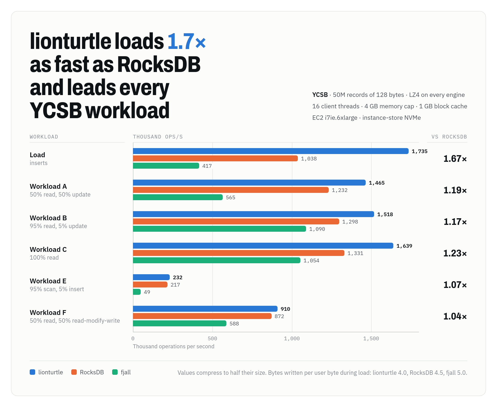

# lionturtle

[](https://crates.io/crates/lionturtle)
[](https://docs.rs/lionturtle)
[](https://github.com/danthegoodman1/lionturtle/actions/workflows/ci.yml)

lionturtle is an embedded key-value store in Rust for Linux and for macOS on Apple silicon. It is a modified version of [TurtleKV](https://github.com/mathworks/turtle_kv) ([paper](https://arxiv.org/abs/2509.10714)): it keeps TurtleKV's TurtleTree, paces its background I/O after [SILK](https://www.usenix.org/conference/atc19/presentation/balmau), and borrows group commit and log recycling from LSM stores such as RocksDB, to keep throughput high and tail latency low.

The TurtleTree is a Bε-tree that merges each full memtable into the tree as one checkpoint, and its nodes buffer several checkpoints before data reaches the leaves. lionturtle writes fewer bytes than RocksDB and fjall, outpaces both on every YCSB workload measured, with LZ4 and without, and keeps read tails short while every write is durable. [DESIGN.md](DESIGN.md#differences-from-the-c-turtlekv) lists where it departs from the C++ TurtleKV.

<picture>
  <source media="(prefers-color-scheme: dark)" srcset="docs/images/ycsb-dark.png">
  
</picture>

## Features

**Fewer bytes written.** A key overwritten within one checkpoint reaches disk once. Loading 50M records without compression wrote 5.8 bytes per user byte, against 7.7 for RocksDB and 9.3 for fjall.

**Short tails with durable writes.** Checkpoints pace their I/O after the [SILK](https://www.usenix.org/conference/atc19/presentation/balmau) paper: each gets only the bandwidth it needs to finish before writers would wait on it. With every update durable at 150k ops/s, read p99 was 0.37 ms against 860 ms for RocksDB.

**Short tails for buffered writes.** A write appends to a log buffer that stays resident between flushes. At 400M records with LZ4, update p99.9 on YCSB B was 45 µs against RocksDB's 526, and insert p99.9 on E 20 µs against 352 ([results](BENCHMARKS.md#ycsb-at-400m-records)).

**Shared syncs.** Synchronous writers share each log write and fsync, and the log writes over retired segments. On a drive with power-loss protection, a durable write costs one 4 KiB write: 27 µs on EC2 instance store.

**Atomic batches.** A batch survives a crash whole or not at all, and no reader sees half of one. Writers commit independently, so one slow insert delays no other writer.

**Snapshots.** `Db::snapshot` returns a handle that any number of reads and iterators can share, and every read through it sees the same batches. Each iterator is a snapshot too.

**One knob trades memory for write cost.** Checkpoint distance χ sets the memtable size. A larger memtable absorbs more overwrites per checkpoint and writes fewer pages.

**Compression that reads one page per miss.** By default, each block holds about as many entries as compress into one 4 KiB page with LZ4, so a read that misses the cache still reads one aligned page, and data that compresses too little to save pages is stored as it is. On values that compress by half, LZ4 cut a 50M-record load's page writes by 40% and raised throughput on every YCSB workload after the load by 17–40% ([results](BENCHMARKS.md#ycsb-at-50m-records)).

**Checked by deterministic simulation.** Each VOPR seed runs a random store configuration through crashes, torn writes, read errors and bit flips on a simulated disk, and checks every answer and every recovery against a model. A failing seed replays exactly.

## Performance

These runs used an EC2 i7ie.6xlarge (24 vCPUs, one instance-store NVMe drive). [BENCHMARKS.md](BENCHMARKS.md) has every result, the setup, and the commands to reproduce them. Every benchmark ran on Linux. macOS has no O_DIRECT or RWF_DSYNC, so there lionturtle buffers its files and ends each durable write with `F_FULLFSYNC`, which flushes the drive's cache.

YCSB on 50M records of 128 bytes that compress by half, with LZ4 on every engine and 16 client threads under a 4 GB memory cap, in thousand ops/s:

| Workload | lionturtle | RocksDB | fjall |
|---|--:|--:|--:|
| Load | 1,710 | 1,008 | 394 |
| A: 50% read, 50% update | 1,473 | 1,180 | 562 |
| B: 95% read, 5% update | 1,496 | 1,248 | 1,066 |
| C: 100% read | 1,617 | 1,209 | 1,130 |
| E: 95% scan, 5% insert | 224 | 214 | 50 |
| F: 50% read, 50% read-modify-write | 917 | 841 | 578 |

Without compression, lionturtle led RocksDB by 1.13–1.66×. Latency in the same runs, from p99 to p99.9:

<picture>
  <source media="(prefers-color-scheme: dark)" srcset="docs/images/latency-dark.png">
  
</picture>

Durable writes: workload A on 20M records of 1 KB, with 128 client threads under a 3 GB memory cap, and every update durable before it returns. Each engine ran five minutes at each fixed rate. As the rate rises, RocksDB's deferred compaction pushes its p99 to 860 ms and its p99.9 past a second, while lionturtle's p99 stays under half a millisecond:

<picture>
  <source media="(prefers-color-scheme: dark)" srcset="docs/images/durable-dark.png">
  
</picture>

| Durable ops/s | Engine | Read p99 | Read p99.9 | Update p99 | Update p99.9 |
|---|---|--:|--:|--:|--:|
| 70k | lionturtle | 0.24 ms | 0.88 ms | 0.26 ms | 1.1 ms |
| | RocksDB | 3.2 ms | 14 ms | 5.4 ms | 17 ms |
| | ScyllaDB | 9.3 ms | 31 ms | 9.3 ms | 30 ms |
| 150k | lionturtle | 0.37 ms | 6.7 ms | 0.47 ms | 7.8 ms |
| | RocksDB | 860 ms | 1.5 s | 863 ms | 1.5 s |

ScyllaDB peaked at 130k–152k ops/s, so it has no 150k row. In closed loop over 9 minutes or more, sustained throughput was 253k ops/s for lionturtle, 205k for RocksDB and 88k for ScyllaDB.

### Trade-offs

- **Memory.** RSS runs about twice RocksDB's: 2.8 GB against 1.3 GB under 128 durable writers.
- **Writes at full load.** When merging falls behind, writers wait. In closed loop, the slowest durable update took 0.80 s against RocksDB's 86 ms, though update p99.9 was 11 ms against 19 ms.
- **Scan medians.** A scan merges every buffer level on its path, so its median runs above RocksDB's: 58 µs against 49 at 400M records with LZ4, though p99.9 was 514 µs against 755.
- **Read p99 under writes.** At 50M records with LZ4, read p99 on workload A was 129 µs against RocksDB's 120, though p99.9 was 248 µs against 291.

## Quick start

```rust
use std::sync::Arc;
use lionturtle::storage::FsStorage;
use lionturtle::{Db, Options, WriteOp};

let db = Db::open(Arc::new(FsStorage::new("data")?), Options::default())?;
db.put(b"apple", b"red")?;
// One log record: recovery keeps both ops or neither, and readers never see one without the other.
db.write(&[WriteOp::put(&b"banana"[..], &b"yellow"[..]), WriteOp::delete(&b"apple"[..])], true)?;
let value = db.get(b"banana")?;
let rows = db.scan(b"a", Some(b"c"), 100)?;
let mut it = db.iter(b"", None); // a snapshot as of this call
while let Some((key, value)) = it.next()? { /* ... */ }

// Reads through one snapshot agree with each other, whatever is written meanwhile.
let snap = db.snapshot();
let fruit = snap.prefix(b"b"); // keys starting with "b", ascending
let newest = snap.iter_rev(b"a", Some(b"c")); // [a, c), descending
db.sync()?;
```

```console
cargo run --release -p lionturtle --example quickstart
```

The API is `put`, `delete`, `write` for batches, `get`, `scan`, `iter`, `iter_rev`, `prefix`, `prefix_rev`, `snapshot`, `sync`, `checkpoint` and `stats`. A `Snapshot` offers the same reads. Keys run to 65,535 bytes and values to 16 MiB.

## C and C++

The `lionturtle-c` crate builds lionturtle as a static and a shared library, `liblionturtle_c`, with a C header, [`lionturtle.h`](lionturtle-c/include/lionturtle.h), and a C++17 wrapper, [`lionturtle.hpp`](lionturtle-c/include/lionturtle.hpp). Each [GitHub release](https://github.com/danthegoodman1/lionturtle/releases) attaches both libraries and headers for Linux x86_64, Linux arm64 and macOS arm64, or you can build them:

```console
cargo build --release -p lionturtle-c   # target/release/liblionturtle_c.{a,so,dylib}
```

```cpp
#include "lionturtle.hpp"

lionturtle::Db db("data");
db.put("apple", "red");
lionturtle::Batch batch;
batch.put("banana", "yellow").erase("apple");
db.write(batch, /*sync=*/true);  // one atomic, durable write
if (auto v = db.get("banana")) std::cout << v->view() << "\n";
for (auto it = db.prefix("b"); it.next();) std::cout << it.key() << " " << it.value() << "\n";
```

```console
c++ -std=c++17 -Iinclude app.cpp lib/liblionturtle_c.a -lutil -lrt -lpthread -lm -ldl   # Linux
c++ -std=c++17 -Iinclude app.cpp lib/liblionturtle_c.a                                  # macOS
```

C functions return an `lt_status`, and the C++ wrapper throws `lionturtle::Error`. A `Db` and its snapshots serve any number of threads at once; use each iterator and batch from one thread at a time. Values come back without a copy: `lt_get` returns a handle to the store's bytes. `scan` and `stats` are Rust-only.

## Configuration

`Options` and `TreeConfig` fields, with defaults:

| Field | Default | Effect |
|---|---|---|
| `checkpoint_distance` | 32 | Memtable size in leaf-sized batches (χ). Larger cuts write amplification and costs memory. |
| `cache_bytes` | 1 GiB | Block and page-image cache. A checkpoint keeps its newest quarter of this in unwritten pages, and applying waits once its unwritten pages pass half. |
| `memtable` | `BBTree` | Memtable implementation: `BBTree`, `SkipList`, or `BTree` |
| `max_frozen` | 2 | Frozen memtables allowed to await checkpointing before writers wait |
| `wal_buffer_bytes` | 1 MiB | Log bytes buffered before a write to the file |
| `merge_threads` | 8 | Threads for parallel merges and page writes; 0 uses the caller's rayon pool. Each adds reads in flight and holds memory. |
| `background` | true | Checkpoint on background threads; with false, callers drive `checkpoint_step` |
| `pace_checkpoints` | true | Spread each background checkpoint's I/O over three quarters of the time its memtable took to fill |
| `preallocate_log` | false | Zero-fill each log segment a few MiB ahead of its writes, so durable writes overwrite allocated space. Reused segments already do; this covers a new store's first segments and writes them twice. |
| `compression` | `Lz4` | `Lz4` sizes each data block to compress into one 4 KiB page and compresses it as its page is written, so a point read still reads one page. Cached blocks stay uncompressed, so only reads from disk decompress. While blocks would hold under an eighth more entries per page, pages are stored as with `None`, and one block in eight is compressed to tell when that changes. A store may switch either way between opens. lionturtle 0.4.0 and later read compressed pages; earlier versions report them as corrupt. |
| `tree.leaf_size` | 4 MiB | Leaf and flush batch size |
| `tree.max_levels` | 4 | Buffer levels per node. More levels cut write amplification and slow reads. |
| `tree.filter_bits` | 12 | Bloom filter bits per key |
| `tree.max_pivots` | 64 | Pivots per node before it splits |

Under a memory cap that counts page cache, such as a container's, transparent huge pages in the application's heap leave less of the cap for the page cache that lionturtle reads through. mimalloc asks for them on its arenas. Set `MIMALLOC_ALLOW_THP=0`, or call `prctl(PR_SET_THP_DISABLE, 1, 0, 0, 0)` at startup, as kvbench does: on YCSB C at 50M records with LZ4 under a 4 GB cap, huge pages halved lionturtle's page cache and cost it 27% of its throughput.

## Compared with RocksDB and fjall

| | lionturtle | RocksDB | fjall 3 |
|---|---|---|---|
| Structure | Bε-tree, checkpointed once per memtable | Leveled LSM tree | Leveled LSM tree |
| Atomic batches | To recovery and to readers | `WriteBatch` | Batches across keyspaces |
| Snapshots | Explicit handles; each iterator reads one | Explicit snapshots | Explicit snapshots |
| Transactions | None | Pessimistic and optimistic | Serializable single-writer; optimistic with conflict checks |
| Namespaces | One keyspace | Column families | Keyspaces |
| Iteration | Forward, reverse, prefix | Forward, reverse, prefix | Forward, reverse, prefix |
| Compression | LZ4 per block, on by default | Several codecs | LZ4 |
| Large values | Inline, up to 16 MiB | Inline or BlobDB | Inline or key-value separation |
| Backpressure | Writers wait while two frozen memtables await checkpoints | Slows and stops writes on L0 files and pending compaction | Delays writes as L0 runs pile up |

## Documentation

- [BENCHMARKS.md](BENCHMARKS.md): every benchmark result, how each ran, and the commands to reproduce it.
- [DESIGN.md](DESIGN.md): the write path, the TurtleTree, reads and visibility; durability guarantees; how lionturtle differs from the C++ TurtleKV; and what the tests check.
- [RELEASING.md](RELEASING.md): how merges to `main` become crates.io releases.

## Development

```console
cargo test --release                                   # unit, model and threaded tests
cargo run --release --bin vopr -- --seeds 1000         # 1,000 simulation seeds from a random start
cargo run --release --bin vopr -- --seed 42 --verbose  # replay one seed
cargo run --release -p kvbench --features rocksdb -- --engine lionturtle --records 10000000
cargo run --release -p kvbench --bin indexbench        # bbtree vs skip list vs BTreeMap
cargo run --release --bin simperf                      # deterministic write amplification across χ
lionturtle-c/tests/run.sh                              # C and C++ API tests
cbindgen --config lionturtle-c/cbindgen.toml --crate lionturtle-c --output lionturtle-c/include/lionturtle.h
```

The last command regenerates the C header after a change to `lionturtle-c/src/lib.rs`. The README's charts come from the data in `docs/images/charts.html`; after editing it, `docs/images/render.sh` renders them again with headless Firefox and ImageMagick.

CI runs rustfmt, clippy with warnings as errors, the Rust, C and C++ tests on x86_64 and arm64 Linux and on Apple silicon macOS, a check that the C header matches the bindings, and 300 simulation seeds on every pull request, plus 10,000 seeds nightly. Each merge to `main` publishes a new version to crates.io and attaches the C libraries to its GitHub release.
